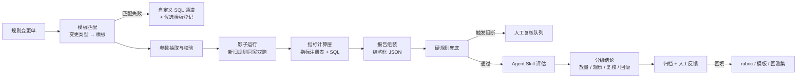

# 风控规则变更业务验证：工程实现

> 系列：AI SRE 实践笔记 · 02
> 范围：规则变更后的业务影响验证
> 状态：线上运行（受数据敏感性限制，不披露业务数值）
> 背景与判断：[问题与思考](../thinking/02-风控规则变更业务验证.md)

## 0. 范围与前提

本文实现规则变更后的业务验证：验证逻辑模板化、影子运行取数、指标计算与 Agent 评估。规则语法校验、引擎性能等技术与功能验证不在本文范围内。

**输入**：一张规则变更单 + 一段影子运行窗口。

```json
{
  "change_id": "RC-2026-1023-001",
  "rule_id": "risk.rule.credit.limit.v3",
  "scene": "credit_decision",
  "change_type": "threshold_adjust",
  "description": "首贷额度上限从 5w 调整到 8w，新客维持不变",
  "expectation": {
    "expected_hit_delta": "+3% ~ +5%",
    "target_population": "老客、近 6 个月无逾期",
    "unacceptable": "新增命中中误杀率超过基线 1 倍，或释放金额超出预算"
  },
  "window": {"start": "...", "end": "..."},
  "owner": "..."
}
```

**输出**：一份结构化评估报告，包含四类维度的指标对比、风险结论和证据引用。报告给人看，也可以被下游审批流消费。

**非目标**：不负责放量决策本身，不修改规则，不替代审批。Agent 输出的是建议和证据，签字仍然是人。

**前提**：

- 规则引擎支持版本化，且能把新版本以影子模式旁路执行（只落决策结果，不触发下游动作）
- 有决策流水表，能按请求 ID 关联新旧版本的判定结果
- 有误杀、漏杀、资损、客诉的基线数据或可替代的先行指标

## 1. 总体链路



链路里有三个环节决定了成败：

1. **模板匹配**决定验证方案就绪要多久。
2. **双跑的可比性**决定指标可不可信。
3. **硬规则兜底**决定 Agent 出错时后果有多大。

## 2. 实现步骤

### 2.1 变更单接入与模板匹配

模板按 `change_type` 匹配，不按 `rule_id` 匹配——同类变更的验证问题是同一套，规则只是参数不同。

| change_type | 模板 | 关键参数 |
| --- | --- | --- |
| `threshold_adjust` | 阈值调整 | 阈值、分群维度、观察窗口 |
| `rule_add` | 新增规则 | 规则表达式、与存量规则的重叠范围 |
| `rule_remove` | 规则下线 | 规则 ID、历史命中人群 |
| `logic_modify` | 逻辑修改 | 变更点、受影响分支 |

匹配失败时不硬套，走自定义 SQL 通道，但必须登记：`change_type`、用到的指标、SQL 位置、耗时。登记数据用来判断哪些自定义逻辑值得抽象成新模板。规则是「同类自定义验证出现频次超过阈值 → 提交模板提案」，而不是靠人拍脑袋决定扩张方向。

**参数抽取**优先用确定性规则（变更单字段、规则引擎元数据）。只有描述里的窗口、人群这类自然语言信息才交给模型抽取，抽完回填成结构化 JSON，由申请人确认后才进入后续流程——参数错了，后面全错，这一步必须有人的确认。

### 2.2 影子运行与数据准备

**双跑要求**：同一时间窗、同一批请求，新旧规则各判一次。按 `request_id` 关联，得到四类结果：

| | 旧规则命中 | 旧规则未命中 |
| --- | --- | --- |
| **新规则命中** | 持续命中 | 新增命中 |
| **新规则未命中** | 释放命中 | 持续放行 |

只有「新增命中」和「释放命中」是变更带来的真实差异，其余是噪声基线。

必须处理的几件事：

- **副作用隔离**：影子命中只写决策结果表，不产生拦截、审核单、通知、外呼，也不调下游。隔离失败会直接污染线上。
- **外部依赖快照**：名单、模型分、额度这类数据在窗口内会变。要么固定版本，要么在报告里标注版本和变更时间，否则差异归因不清。
- **采样与样本量**：全量双跑最准，但成本高。抽样时要保证分群覆盖，不能只抽大流量场景。每个指标要有最小样本要求，未达到就标「样本不足」。
- **窗口选择**：避开大促、发版、名单批量更新。多规则同时变更时，要么拆窗口，要么在报告里明确「影响不可单独归因」。

### 2.3 指标计算层

指标用注册表管理，每个指标一条记录：`metric_id`、维度、SQL 模板、分群维度、最小样本、版本号。报告里的每个数字都能回溯到 `metric_id + 版本 + SQL`。

| 维度 | 指标 | 计算方式 |
| --- | --- | --- |
| 命中 | `hit_volume_delta` | 新增命中量 − 释放命中量（或分别看） |
| 命中 | `hit_rate_delta` | 新规则命中率 − 旧规则命中率，附 Wilson 置信区间 |
| 命中 | `population_shift` | 按分群（新老客、渠道、额度段）对比命中分布，用 PSI 或分布差异 |
| 误杀 | `false_positive_est` | 新增命中中，人工审核结论为「通过」的比例；无标注时抽检估算 |
| 漏杀 | `false_negative_est` | 释放命中中，事后申诉 / 回捞确认为风险的比例 |
| 资损 | `released_amount` | 释放命中案件的金额合计 |
| 资损 | `expected_loss` | 释放金额 × 该人群历史风险率 |
| 客诉 | `complaint_est` | 新增拦截量 × 同类场景历史客诉率（先行指标，滞后回填实际值） |

几个实现上的注意点：

- **率类指标必须带置信区间**，不能只给一个数。样本 80 条时「命中率下降 2%」很可能就是噪声。
- **结构变化优先于总量变化**。总量持平但人群结构变了，是更典型的「人看不出来」的情况，报告要把分群差异显式列出来。
- **先行指标和滞后指标分开**。客诉、申诉结论有天然滞后，报告里要标注数据截止时间，避免拿不完整的数据下结论。
- **基线有两套**：同窗口旧规则（严格对比）和前 N 天同场景（看趋势）。报告里并列展示，便于区分「规则影响」和「业务自然波动」。

### 2.4 报告组装

送给 Agent 的是组装好的聚合报告，不是原始明细。结构大致如下：

```json
{
  "change": {"change_id": "...", "rule_id": "...", "change_type": "...", "expectation": {}},
  "window": {"start": "...", "end": "...", "data_cutoff": "..."},
  "sample": {"requests": 0, "new_hits": 0, "released_hits": 0, "sufficient": true},
  "data_quality": {"external_snapshot": "...", "events": [], "warnings": []},
  "metrics": [
    {
      "metric_id": "hit_rate_delta",
      "metric_version": "v3",
      "dimension": "hit",
      "baseline": 0,
      "current": 0,
      "delta": 0,
      "ci": [0, 0],
      "sample": 0,
      "status": "normal | watch | block | insufficient"
    }
  ],
  "flips": {"new_hit_samples": [], "released_samples": []}
}
```

两条约束：

- `metrics` 里的 `status` 由**硬规则**计算，不由模型生成。
- `flips` 只放少量抽样样本，用于让模型解释「翻转的是哪类案件」，不放全量明细。

### 2.5 Agent 评估协议

以 Skill 形式封装，包含指令、rubric、报告 schema 和取数工具。

```text
skill/risk-change-eval/
├── SKILL.md                 # 角色、任务、判定规则、输出 schema
├── references/rubric.md     # 四维度三档阈值、结论分级定义
├── references/report.json   # 报告输入 schema
└── scripts/fetch_detail.py  # 按 metric_id 下钻明细（只读、有审计）
```

**Prompt 骨架：**

```text
你是风控规则变更的风险评估员。输入是一份已经计算好的聚合指标报告。
你的任务是解释指标变化、识别预期外的影响、对照 rubric 给出结论。

判定规则：
1. 只能引用输入中出现的数值，不得自行计算、推算或补全缺失指标。
2. 每条结论必须绑定 metric_id，并说明它支持哪一条判断。
3. 变更说明里的 expectation 只作为参考，不作为判定依据。判定以 rubric 为准。
4. 指标样本不足、数据口径异常或存在未归因的外部变化时，写入 missing_info，不得推测。
5. 结论只能是 pass / watch / review / rollback 四档之一。
6. 不要输出与指标无关的业务常识或泛泛而谈的风险提示。

输入：
<change>{...}</change>
<rubric>{...}</rubric>
<report>{...}</report>

输出 JSON，字段遵循给定 schema。
```

**对话式深挖**：报告之后可以继续追问（「新增命中的金额集中在哪个渠道」「这 200 条翻转案件有什么共同特征」）。追问时 Agent 通过 `fetch_detail` 取数，工具返回的仍然是计算层产出的聚合或抽样结果。**取数必须走工具、留审计记录**，不能靠模型从上下文中回忆数字。

**输出校验**（在代码里做）：

- schema 校验
- 引用的 `metric_id` 必须存在于本次报告
- 引用的数值必须能在报告里精确匹配到
- 结论与硬规则冲突时，以硬规则为准，并记录冲突样本
- 校验失败 → 重试一次 → 仍失败则转人工

**稳定性控制**：temperature=0，固定 Skill 版本、Prompt 版本、模型版本和 rubric 版本，全部记录到报告里。rubric 变更时跑回归集。

### 2.6 硬规则与分级

Agent 之前先跑一层确定性规则：

| 条件 | 处置 |
| --- | --- |
| 任一维度 `status = block` | 直接进人工复核，Agent 只写解释，不改结论 |
| `expected_loss` 超出预算上限 | 同上 |
| 样本不足或双跑未对齐 | 结论标「不可判定」，转人工 |
| 窗口内有大促、发版、外部数据更新 | 报告标注，结论降一级 |
| 全部维度 `normal` 且在预期内 | 可放量，抽样复核 |

分级的目的是控制误报带来的负担。所有变更都进人工复核，复核队列很快就会没人看，召回也就名存实亡了。

### 2.7 人工复核与反馈闭环

- 人工复核只需要看报告和证据，不需要重新跑数。复核结论（通过 / 驳回 / 修正）回填。
- 人工结论与 Agent 结论不一致的样本单独归档，作为分歧集，定期分析是 rubric 的问题还是 Prompt 的问题。
- 每次复核的成本要记录，用来判断模板和 rubric 是否真的在收敛。

### 2.8 评测与迭代

**回测集**：从历史变更里挑样本，用当时的真实影响结论（放量后观察到的结果、事后复盘、申诉数据）作为标签。

| 指标 | 计算方式 |
| --- | --- |
| 漏报率 | 真实有影响的变更中，被判为 pass 的比例 |
| 误报率 | 被判为 review / rollback 的变更中，实际无显著影响的比例 |
| 结论一致性 | 同一份报告重复评估，结论相同的比例 |
| 引用准确率 | 报告中数值引用能在输入中匹配的比例 |
| 模板覆盖率 | 用模板完成的验证 / 全部验证 |
| 人工介入率 | 进入人工复核的变更占比 |

评测要按变更类型、规则复杂度、样本量分层看。总体指标好看但某一类系统性漏报，是最危险的情况。

### 2.9 运行观测

- **耗时拆解**：变更单接入 → 双跑完成 → 指标计算 → Agent 评估 → 人工复核。哪一段慢，决定了「近实时」卡在哪。
- **任务失败分类**：模板缺失、样本不足、双跑数据未对齐、Agent 输出格式错误、取数超时。失败要能自动降级到人工，而不是卡住整条链路。
- **成本**：单次 token 与计算成本。对话式追问的次数也要计入，否则成本会从追问里漏出去。

## 3. 线上运行

方案已在线上运行，覆盖规则变更后的自动评估和报告产出。受数据敏感性限制，本文不披露业务规模、指标数值和效果数据，只记录机制和判断。

线上运行形态：

- 变更单触发 → 模板匹配 → 影子双跑 → 指标计算 → Agent 报告 → 分级结论，全链路自动。
- 未命中模板的变更走自定义 SQL 通道，人工补验证逻辑，同时登记为候选模板。
- 报告的结论分四档，只有 `pass` 可以不经人工直接进入放量流程，其余都要人确认。
- 所有报告、指标版本、Skill 版本、rubric 版本都归档，可回溯。

线上运行中确认了三个设计取舍是必要的：

1. **Agent 不计算**。把计算锁在指标层，报告可复核，也避免了「模型算错但看不出来」。
2. **硬规则兜底**。关键维度的阻断判断不能交给模型，模型只做解释和归因。
3. **预期只作参考**。如果把变更单里的预期直接当成判定标准，写一个宽松预期就能让任何变更「在预期内」。

## 4. 演进计划

| 阶段 | 目标 | 验收标准 |
| --- | --- | --- |
| 已完成 | 模板化验证 + 影子双跑 + Agent 报告 + 分级 | 线上稳定运行，报告可回溯 |
| 进行中 | 扩充模板库，降低自定义 SQL 占比 | 模板覆盖率持续上升 |
| 进行中 | 积累回测集，校准 rubric 阈值 | 漏报率、误报率可度量并收敛 |
| 下一步 | 对话式深挖接入取数工具 | 追问结论可审计、可复现 |
| 下一步 | 评估结论对接审批流 | 报告与分级结论可直接消费，减少人工转抄 |

## 5. 已知边界与坑

| 问题 | 影响 | 应对 |
| --- | --- | --- |
| 规则优先级与短路 | 逐规则双跑对比 ≠ 上线后的整体效果 | 以整体决策结果对比为主，单规则对比只作归因参考 |
| 影子流量采样偏差 | 小流量、长尾场景样本不足 | 分群抽样 + 最小样本阈值，不足时标「不可判定」 |
| 外部数据变化 | 名单、模型分、额度更新污染对比结果 | 固定快照版本，或标注变更时间，避开更新窗口 |
| 客诉 / 申诉滞后 | 指标不完整，结论偏乐观 | 标注数据截止时间，用先行指标估算，事后回填校准 |
| 人工审核标注偏差 | 误杀、漏杀估算有偏 | 分层抽样，记录标注口径；长期用申诉数据交叉验证 |
| 口径变更 | 模板数字对、结论错 | 指标版本化 + 口径变更评审 + 定期回测 |
| 多规则同时变更 | 无法单独归因 | 拆窗口、拆变更单，或在报告中显式标注不确定 |
| 自定义 SQL 沉淀不下来 | 模板覆盖率长期停滞 | 登记 + 频次统计 + 模板提案机制 |
| 对话式取数不可控 | 追问结论无法复现 | 取数必须走工具、带审计、走同一套指标口径 |
| 预期写得过宽 | 什么都「在预期内」 | 预期只作参考，rubric 独立判定；对预期本身做合理性检查 |

## 6. 下一步

1. **模板库扩充**：把高频自定义验证抽象成模板，把模板覆盖率作为核心运营指标。
2. **回测集建设**：用历史真实影响标注，形成可回归的评测集，rubric 和 Prompt 变更前必须跑。
3. **对话式能力工程化**：把追问常用的下钻路径固化成工具调用，避免模型自由发挥导致口径漂移。
4. **评估结论消费方对接**：让审批流、放量平台直接消费报告和分级结论，减少人工转抄带来的信息损耗。
5. **模板与 rubric 治理**：明确模板、指标口径、rubric 的维护责任人和变更评审流程，避免资产随人流动而腐化。
