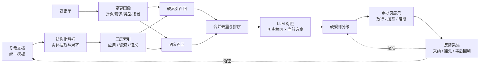

# 应用发版二次故障风险控制：工程实现

> 系列：AI SRE 实践笔记 · 03
> 范围：应用发版变更的二次故障风险识别与提示
> 状态：线上运行（受数据敏感性限制，不披露业务数值）
> 背景与判断：[问题与思考](../thinking/03-应用发版二次故障风险控制.md)

## 0. 范围与前提

**输入**：一张应用发版变更单。

```json
{
  "change_id": "CHG-2026-1023-007",
  "app": "order-service",
  "change_type": "code_release | config | scale | data | dependency",
  "release_mode": "full | canary | rolling",
  "content": "订单超时关闭任务从单线程改为线程池，核心数 8，队列 2000",
  "resources": ["mysql:order_db", "redis:order_cache"],
  "window": {"start": "...", "end": "..."},
  "owner": "..."
}
```

**输出**：一份风险提示，挂到审批页；根据分级结果触发放行、加签或阻断。

```json
{
  "change_id": "CHG-2026-1023-007",
  "decision": "pass | review | block",
  "recalls": [
    {"incident_id": "INC-2025-0312", "matched_by": ["app", "resource", "root_cause"], "score": 0.87}
  ],
  "risks": [
    {
      "incident_id": "INC-2025-0312",
      "risk": "线程池上限可能不足以承接积压任务，重演队列打满导致的任务丢失",
      "condition": "发布初期流量突增，且关闭任务单次耗时高于 200ms",
      "checks": ["核对线程池队列长度与峰值任务量", "确认任务丢失后的补偿机制"],
      "evidence": ["root_cause", "trigger_condition", "improvement_item"]
    }
  ],
  "no_recall": false,
  "missing_info": []
}
```

**非目标**：不预测未来会发生什么故障，只基于历史事实提示风险；不替代变更评审，不自动修改变更方案；不负责改进项的闭环追踪，只消费其状态。

**前提**：

- 复盘使用统一模板，根因、触发条件、改进项是独立字段
- 有 CMDB 或等价的应用—资源关系，能把变更单里的资源名映射到标准实体
- 变更单有结构化字段（应用、变更类型、发布方式、资源、时间窗）
- 审批流支持外部服务回调，能在审批页展示结果并执行阻断/加签

## 1. 总体链路



三个环节决定成败：

1. **实体对齐**：复盘、CMDB、变更单三处的应用名和资源名能不能对上。对不上，召回就是空的。
2. **召回策略**：硬索引保底线，语义召回补盲区。只做其中一种都会出问题。
3. **分级边界**：哪些情况让模型提示，哪些情况必须硬规则阻断。

## 2. 实现步骤

### 2.1 复盘知识入库

复盘模板的字段直接成为知识单元的结构化字段，不再从自由文本里猜：

| 字段 | 用途 |
| --- | --- |
| `incident_id` / 时间 / 严重度 | 元数据、排序、时效衰减 |
| `apps[]` | 应用层索引；一次故障涉及多个应用时全部挂上 |
| `resources[]` | 资源层索引（DB、缓存、MQ、配置项、第三方依赖） |
| `phenomenon` | 故障现象，用于语义召回和模型理解 |
| `root_cause` | 根因描述 + 根因类别（容量/依赖/配置/兼容性/数据/流程/人为） |
| `trigger_condition` | 触发条件：变更类型、发布方式、时间、流量、依赖状态 |
| `impact` | 影响面：用户、订单量、金额、时长 |
| `improvement_items[]` | 改进项及闭环状态，用于判断风险是否仍然存在 |
| `related_change` | 引发故障的那次变更，用于判断「同类动作」 |

**切分策略**：以「一次故障」为一个知识单元，不按段落切。长文档按字段分块（现象 / 根因 / 处置 / 改进项），但每个块都带同一个 `incident_id`。检索命中的永远是故障，不是段落——否则模型会拿着半截描述编故事。

**实体抽取与对齐**：

- 应用、资源从模板字段直接取，不从正文抽
- 资源名做标准化（`mysql:order_db`），别名表维护简称、旧名、域名、集群名
- 无法对齐的实体进待处理队列，按出现频次排序处理
- 一次故障涉及多个应用或资源时，全部建索引，不做主次区分

**入库触发**：复盘提交或更新时自动增量入库。**复盘质量门禁**：`root_cause` 为空或只有「操作不当」「沟通不畅」这类泛化描述时，允许入库但标记 `low_quality`，不参与硬规则阻断，只作为语义召回的弱证据。

### 2.2 变更单解析

优先使用结构化字段，不依赖模型：

```text
change_id, app, change_type, release_mode, resources[], window, content
```

只有 `content` 是自由文本。模型负责从里面抽取补充信息——变更动作（改配置 / 换实现 / 加依赖）、影响对象、潜在风险面——回填成结构化字段，在审批页展示给提交人确认。**确认后的画像才用于召回**，避免模型理解偏差一路传导到最终结论。

应用和资源同样要过一遍实体对齐，映射到与知识库一致的标准名。

### 2.3 召回

**第一路：硬索引召回。**

```text
命中条件（任一）：
  incident.apps ∩ change.app        非空
  incident.resources ∩ change.resources 非空

加权：
  同应用 + 同资源 + 同变更类型  → 最高
  同应用 + 同资源               → 高
  仅同应用                      → 中
  仅同资源                      → 中（跨应用的同组件故障，价值很高）
```

这一路是确定的，不依赖向量模型，保证「这个应用上次发版挂过」这种强信号一定进候选。

**第二路：语义召回。**

查询文本 = 变更内容 + 变更类型 + 发布方式 + 变更动作；索引文本 = 故障现象 + 根因 + 触发条件。用向量检索取 top-k，覆盖「换了应用、换了说法」的同类问题，比如「连接池打满」与「数据库连接耗尽」。

**合并与排序**：

```text
score = w1·对象匹配 + w2·资源匹配 + w3·语义相似度
      + w4·变更类型匹配 + w5·严重度 − w6·时间衰减
```

同一 `incident_id` 多路命中只保留一条，`matched_by` 记录所有命中原因——这是后面解释「为什么相关」的依据。

**阈值与无召回**：低于阈值的候选不进模型。候选为空时，输出 `no_recall: true` 并在审批页明确展示「未找到相关历史故障，本提示不代表无风险」。这句文案很重要，否则空白会被读成「安全」。

### 2.4 模型对照

模型只处理召回后的候选，输入是结构化字段 + 关键段落摘录，输出对当前变更的风险判断。

**Prompt 骨架：**

```text
你是变更风险评审助手。下面有一份待评审的变更，以及该系统历史上的故障记录。
请判断：这些历史故障中，哪些可能被本次变更再次触发。

规则：
1. 只能基于给出的历史故障记录判断，不得编造不存在的故障、时间或数据。
2. 每条风险必须引用 incident_id，并说明依据是哪个字段（根因 / 触发条件 / 改进项）。
3. 必须明确写出触发条件；当前变更不满足触发条件时，说明为什么仍然相关或不相关。
4. 历史改进项已闭环且当前变更不涉及该机制时，应降低风险等级并说明理由。
5. 不确定时标注「可能相关」，不要强行给出确定结论。
6. 没有可关联的故障时，输出空列表，不要为了填充而牵强关联。

输入：
<change>{...}</change>
<incidents>{...}</incidents>
<improvements>{...}</improvements>

输出 JSON，字段遵循给定 schema。
```

**输出校验**（在代码里做）：

- `incident_id` 必须存在于本次输入的候选中
- `checks` 必须能追溯到某条历史改进项或根因，不允许凭空生成
- 每条 `risk` 必须有对应 `evidence` 字段引用
- 校验失败 → 重试一次 → 仍失败则降级为「仅展示召回结果」，不生成风险结论

**对话式追问**：审批人可以针对某条历史故障追问细节（「上次这个问题的处置过程是什么」「改进项做到哪一步了」）。追问走工具取数，返回原始复盘字段，不由模型凭记忆回答。

### 2.5 分级与阻断

硬规则先于模型执行，模型只做解释，不决定阻断。

| 条件 | 处置 |
| --- | --- |
| 同应用 + 同资源 + 同变更类型，且历史故障为高严重度、时间在有效期内 | 阻断 |
| 同应用 + 同类根因，且对应改进项未闭环 | 加签，要求说明闭环情况 |
| 跨应用 + 同资源，或语义高度相似 | 风险提示，不阻断 |
| 仅弱语义相关 | 展示，不改变流转 |
| 未召回 | 正常流转，记录「未召回」 |

阈值、有效期、严重度范围都做成配置，按应用等级区分。核心应用可以更严，边缘应用可以只提示。

**豁免与申诉**：阻断必须可申诉。豁免需要填写理由并留痕，定期统计豁免率。豁免率过高说明规则过严或有人在绕过流程；豁免理由同时也是校准规则的输入。

### 2.6 审批页集成

对外提供同步接口，审批流在渲染页面时调用：

```text
POST /release-risk/evaluate
  body: change_id + 变更单字段
  resp: decision + recalls + risks + checks + no_recall + missing_info

GET /release-risk/incident/{incident_id}
  resp: 复盘结构化字段 + 关键段落（按权限裁剪）
```

页面展示顺序按审批人的判断路径来：

1. 结论（放行 / 加签 / 阻断）和一句话理由
2. 风险点卡片：历史故障摘要、为什么相关、触发条件是否满足
3. 检查清单：可勾选，勾选结果回传
4. 历史故障详情链接（有权限控制，复盘里可能含敏感信息）
5. 未召回时显著提示，不留白

### 2.7 反馈与评测

**采集事件**：提示展示、检查项勾选、采纳、豁免、阻断后放行、变更后是否发生故障。

**事后回溯**：每次新故障入库时，反查当时那次变更有没有被提示过——

- 提示过且被采纳 → 正样本
- 提示过但被豁免 → 最值得复盘的样本
- 没提示过 → 漏召回，分析是索引没覆盖、实体没对齐，还是召回阈值过高

**回放评测**：取历史变更及其后续故障，离线跑召回与判断，度量：

| 指标 | 计算方式 |
| --- | --- |
| 召回率 | 事后确认相关的故障中，被召回的比例 |
| 准确率 | 召回的故障中，确实相关的比例 |
| 阻断准确率 | 被阻断的变更中，确认存在真实风险的占比 |
| 提示采纳率 | 检查项被勾选/确认执行的比例 |
| 豁免率 | 豁免的变更 / 被阻断或加签的变更 |
| 端到端时延 | 变更单提交 → 审批页可展示 |
| 知识覆盖率 | 有结构化索引的故障 / 全部故障 |
| 入库时延 | 故障发生 → 复盘可检索 |

评测要按应用等级和变更类型分层看。总体指标好看、但核心应用的系统性漏召回，是最危险的情况。

### 2.8 运行观测

- **召回构成**：硬索引命中 vs 语义命中各占多少，语义召回如果长期没有贡献就可以降权
- **无召回比例**：过高说明索引覆盖不足，过低可能是阈值太松
- **模型失败率**：输出校验失败、超时、降级的比例
- **索引新鲜度**：最近入库时间、待对齐实体数量、低质量复盘占比
- **成本**：单次调用 token、每次召回条数

## 3. 线上运行

方案已在变更审批环节运行。受数据敏感性限制，本文不披露业务规模、召回率和效果数值。

线上运行形态：

- 变更单提交后自动触发评估，结果直接挂在审批页
- 高严重度的同对象、同资源、同类型变更触发阻断或加签；其余只做提示
- 未召回时显式提示，不按「无风险」处理
- 所有提示、豁免、放行记录留痕，支持事后回溯

线上运行中确认的三个设计取舍：

1. **硬索引必须单独存在。** 只靠向量检索，最容易漏掉恰恰最该命中的那几条——同一应用、同一资源的直接关联。语义召回是补充，不是主力。
2. **模型不能决定阻断。** 阻断涉及流程和业务损失，判定必须落在可解释、可配置的硬规则上；模型的价值在于解释和给检查项。
3. **「未召回」必须显式表达。** 留白在审批场景里等同于「安全」，会把索引缺失伪装成低风险。

## 4. 演进计划

| 阶段 | 目标 | 验收标准 |
| --- | --- | --- |
| 已完成 | 复盘结构化入库、双路召回、模型对照、审批页展示与阻断 | 线上稳定运行，提示可追溯 |
| 进行中 | 复盘质量治理：根因字段规范、低质量复盘清理 | 低质量复盘占比持续下降 |
| 进行中 | 实体对齐自动化：别名表 + CMDB 联动 | 待对齐实体数量收敛 |
| 下一步 | 跨应用相似故障推荐 | 同资源、同类根因的跨应用召回率提升 |
| 下一步 | 回溯分析工具化 | 漏召回原因自动归类，反哺索引与阈值 |

## 5. 已知边界与坑

| 问题 | 影响 | 应对 |
| --- | --- | --- |
| 根因写得泛化 | 召回后也无信息量，模型无从判断 | 质量门禁 + 根因字段规范 + 低质量复盘不参与阻断 |
| 实体命名不一致 | 索引对不上，系统性漏召回 | 别名表、CMDB 映射、未对齐队列按频次治理 |
| 复盘滞后 | 新教训在入库前保护不到同类变更 | 监控入库时延，重大故障走快速入库通道 |
| 一次故障涉及多应用 | 只挂一个对象会漏召回 | 全部对象和资源都建索引，不做主次 |
| 语义召回过泛 | 跨应用的噪声淹没真正相关的条目 | 阈值 + 排序权重 + 分层评测，必要时降权 |
| 阻断过严 | 审批人绕过流程，风险更隐蔽 | 申诉豁免通道、豁免率监控、规则阈值可按应用配置 |
| 模型编造历史 | 结论不可信，破坏信任 | 强制引用 incident_id 与字段，代码侧校验，失败降级为纯召回展示 |
| 改进项状态不准 | 风险判断依据失真 | 闭环状态从改进项系统同步，不由人工维护 |
| 向量模型或索引更新 | 召回结果漂移 | 固定 embedding 版本，更新时跑回放评测 |
| 权限与敏感信息 | 复盘内容泄露到无权限的审批人 | 详情接口按角色裁剪，页面只展示摘要 |

## 6. 下一步

1. **复盘质量治理**：把根因、触发条件、改进项三个字段的填写质量纳入复盘评审，低质量复盘不得关闭。
2. **实体对齐自动化**：用 CMDB 关系自动生成候选别名，人工只做确认，把待对齐队列压下去。
3. **回溯闭环工程化**：新故障入库时自动反查历史变更提示，产出漏召回归因报告，驱动索引和阈值调整。
4. **检查清单闭环**：把勾选结果接回改进项系统，形成「提示 → 执行 → 闭环」的完整链路。
5. **与发布平台联动**：在发布窗口、发布方式上做前置校验，把部分风险拦截在审批之前。
