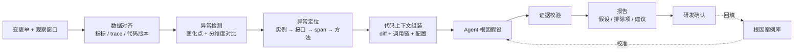

# 应用变更期间指标波动异常根因分析：工程实现

> 系列：AI SRE 实践笔记 · 04
> 范围：变更观察窗口内的指标异常根因分析
> 状态：方案设计
> 背景与判断：[问题与思考](../thinking/04-应用变更期间指标波动异常根因分析.md)

## 0. 范围与前提

本文实现变更观察窗口结束后的指标异常根因分析：从指标波动出发，定位到调用链和方法，结合变更 diff 与代码实现，产出带证据和验证方法的根因报告。

**输入**：

```json
{
  "change_id": "CHG-2026-1023-021",
  "app": "order-service",
  "release": {
    "version": "v2.14.0",
    "commit": "a1b2c3d",
    "mode": "rolling",
    "instances": ["order-01", "order-02", "order-03"]
  },
  "window": {"start": "...", "end": "..."},
  "diff_ref": "a1b2c3d^..a1b2c3d",
  "baseline": {"policy": "same_weekday_time", "days": 7}
}
```

**输出**：一份根因分析报告，包含异常摘要、根因假设、排除项、代码级建议和数据缺口。

```json
{
  "change_id": "CHG-2026-1023-021",
  "verdict": "watch | rollback | fix | normal",
  "anomalies": [
    {
      "metric": "http.server.duration.p99",
      "entity": "order-query",
      "pattern": "level_shift",
      "onset": "...",
      "duration_minutes": 0,
      "magnitude": {},
      "affected_instances": ["order-03"]
    }
  ],
  "hypotheses": [
    {
      "id": "H1",
      "cause": "新增的批量查询在循环内逐条调用下游，连接池等待时间上升",
      "category": "dependency | concurrency | capacity | config | sql | logic",
      "confidence": "high | medium | low",
      "evidence": [
        {"type": "trace", "ref": "span-id", "note": "..."},
        {"type": "code", "ref": "OrderQueryService.java:142", "note": "..."},
        {"type": "diff", "ref": "a1b2c3d", "note": "..."},
        {"type": "config", "ref": "pool.maxActive", "note": "..."}
      ],
      "verification": ["对比 order-01/02 的连接池等待指标", "将循环改为批量调用后回放"],
      "affected": ["order-query"]
    }
  ],
  "excluded": [{"hypothesis": "...", "reason": "..."}],
  "data_gaps": ["order-03 的 trace 采样率不足"],
  "recommendations": [{"target": "OrderQueryService.java:142", "action": "..."}]
}
```

**非目标**：不做通用 APM 或异常检测产品；不自动修改代码；不替代研发对根因的确认；不覆盖变更窗口之外的长周期性能治理。

**前提**：

- 指标可按实例、接口、下游依赖维度查询，且变更前后口径一致
- 有可用的分布式追踪数据，能按 span 关联到实例与方法
- 有代码知识图谱或等价的符号索引，能把方法映射到代码位置
- 能拿到变更对应的 diff 和确切 commit；配置中心有版本信息

## 1. 总体链路



三个环节决定成败：

1. **口径对齐**：指标基线、实例版本、代码 commit 对不齐，后面全错。
2. **定位精度**：能否从指标正确落到 span 和方法。
3. **证据门槛**：没有证据的假设不出报告。

## 2. 实现步骤

### 2.1 数据接入与口径对齐

**指标集合**按应用类型选，但至少覆盖：

| 类别 | 指标 |
| --- | --- |
| 流量 | QPS、请求量，按接口、实例、版本分维度 |
| 延迟 | P50 / P95 / P99，服务端与客户端分别看 |
| 错误 | 错误率、错误码分布、超时数 |
| 资源 | CPU、内存、GC 次数与耗时、线程数 |
| 依赖 | 连接池活跃/等待、下游 RT 与错误率、重试次数 |

**基线策略**：

- 默认取同时段前 7 天，按接口、实例、流量分群对比
- 滚动发布期间按**实例版本**分组，新旧版本分别算基线，再比较
- 窗口前 N 分钟标记为冷启动，单独统计或排除
- 时间对齐要算上采集延迟和时钟偏差，异常起点以指标窗口为准，不用变更时间硬套

**数据质量标记**：指标缺失、trace 采样率过低、代码版本无法定位时，在结果里显式标记，后续结论只能降级，不能默认按正常处理。

### 2.2 异常检测

不用单纯阈值，用「变化点 + 持续性 + 多维度一致性」三件事一起判断。

```text
输入：指标时序（按维度对齐版本）
1. 变化点检测（如 CUSUM、PELT），定位突变起点
2. 计算变化后的持续性：持续 N 个采集点以上才计入
3. 计算幅度：相对基线的变化倍数或分位数偏移
4. 分维度交叉：实例间差异、接口间差异、依赖间差异
5. 多指标相关：延迟、错误、连接池、GC 是否同向变化
输出：anomaly 列表（指标、维度、起点、持续时长、幅度、受影响实体）
```

几个硬性规则：

- **不看整体平均，先看分组。** 滚动发布时整体平均会把版本差异抹平，甚至方向相反。
- **排除冷启动窗口**，否则实例重启会被判成性能退化。
- **区分突变和缓慢漂移**。漂移往往对应容量或资源泄漏，突变往往对应代码逻辑或配置。
- **给最小样本要求**，低流量接口的波动大概率是噪声。

### 2.3 异常定位

从异常实体往下钻：

```text
异常指标 entity
  ├─ 实例维度 → 对比同版本实例，找出离群实例
  ├─ 接口维度 → 找出变化最大的接口
  └─ trace 维度 → 按版本/窗口对比 span 分布
        ├─ 错误 span 集中在哪些服务/方法
        ├─ self time 增长集中在哪些方法
        └─ 下游调用耗时与重试次数变化
```

**self time 计算**：`span.duration − Σ child.duration`。注意异步调用、线程池切换和跨线程埋点会让 self time 失真，这类 span 要标记为低置信度，不能直接当热点。

**候选方法集合**由两部分组成：

- 异常 trace 中的热点方法，按 self time 增量和错误率增量排序
- 本次变更 diff 涉及的方法

两部分取交集优先，交集为空时以热点方法为入口，反向找最近的调用者是否在 diff 中。

### 2.4 代码上下文组装

以变更为锚点，按优先级组装：

| 优先级 | 内容 | 说明 |
| --- | --- | --- |
| 1 | diff 涉及的方法实现 | 变更引入的逻辑 |
| 2 | 热点方法及其中间调用 | 异常真正发生的位置 |
| 3 | 上下游 1~2 跳 | 跨层封装、依赖调用、异步回调 |
| 4 | 关键配置 | 线程池、超时、重试、连接池、缓存开关 |
| 5 | SQL / 远程调用定义 | Mapper、RPC 接口、下游契约 |
| 6 | 按需扩展 | 前几层解释不了时再往外扩 |

**约束**：

- 代码版本必须固定到变更的 commit，报告里记录 `commit` 和 `graph_commit`
- 配置从配置中心取变更时点的快照，并记录版本
- 上下文有 token 预算：diff 和热点方法优先，配置全量保留，其余按调用频率裁剪
- 代码片段必须带文件路径和行号，供后续校验

### 2.5 Agent 归因协议

模型只做归因和解释，不做指标计算。

**Prompt 骨架：**

```text
你是应用性能根因分析员。输入是一次变更的异常指标摘要、调用链定位结果、
变更 diff、相关代码片段和配置。请给出可能导致这些异常的原因。

规则：
1. 只能使用输入中出现的指标、span、代码和配置，不得编造文件、行号、数值或调用关系。
2. 每个根因假设必须引用 evidence（trace span / 文件行号 / diff / 配置项），并说明它解释了哪个异常。
3. 区分「观测到的现象」和「推断出的原因」，不要把推断写成事实。
4. 不得自行计算或补全指标；数值一律引用输入。
5. 每个假设必须给出验证方法，且验证方法要能实际执行。
6. 同时列出排除项：你考虑过但不成立的原因，以及排除依据。
7. 证据不足时输出 unknown 或降低置信度，不要用常识补位。
8. 异步、线程池、动态代理等导致 self time 失真的情况，要主动说明。
9. 多变更叠加、冷启动、采样不足等数据问题，写入 data_gaps。

输入：
<change>{...}</change>
<anomalies>{...}</anomalies>
<trace_localization>{...}</trace_localization>
<diff>{...}</diff>
<snippets>{...}</snippets>
<configs>{...}</configs>

输出 JSON，字段遵循给定 schema。
```

**输出校验**（在代码里做）：

- 引用的文件行号必须存在，片段必须能在源码中匹配
- 引用的 span id、指标名必须存在于本次输入
- 置信度与证据数量一致性检查：高置信但无代码或 trace 证据的，直接降级
- 没有 `verification` 的假设不进入报告
- 校验失败 → 重试一次 → 仍失败则报告降级为「仅现象与定位结果」

**稳定性**：temperature=0，固定模型、Prompt、schema、代码图谱版本，全部写入报告。

### 2.6 报告组装

报告分两层：给 SRE 的摘要和给研发的细节。

**摘要**（变更决策用）：

- 结论：正常 / 需关注 / 建议回滚 / 需修复
- 异常指标与影响范围
- 最高置信根因一句话
- 数据缺口提示

**细节**（研发侧）：

- 每个根因假设：原因、证据、影响接口、验证方法
- 排除项及理由
- 代码级建议：文件、方法、修改方向
- 相关 trace 和指标看板链接

**措辞约束**：假设写「可能导致」，结论写「证据支持」；没有验证就不写「根因已确认」。这看起来是文字问题，实际决定了报告的可信度。

### 2.7 反馈与评测

**研发反馈**：确认 / 部分确认 / 否定 / 无法判断，附原因分类（证据不足、方向错误、代码版本不对、指标误读）。

**回放评测**：取历史变更和已确认的根因，离线跑分析链路，度量：

| 指标 | 计算方式 |
| --- | --- |
| 根因命中率 | 高置信假设与确认根因一致的比例 |
| 误报率 | 被否定的假设 / 全部高置信假设 |
| 定位准确率 | 候选方法中包含真实问题方法的比例 |
| 报告采纳率 | 建议被采纳或转为改进项的比例 |
| 端到端时延 | 观察窗口结束 → 报告产出 |
| 数据完备率 | 指标、trace、代码三方齐全的变更占比 |
| 单位分析成本 | tokens + 计算 / 次 |

评测要按异常类型分层：容量、并发、依赖、配置、代码逻辑。总体指标好看但某一类系统性误判，是最危险的情况。

### 2.8 运行与成本

- **触发时机**：观察窗口结束后自动触发；异常严重度高的变更可在窗口内提前触发一次
- **阶段耗时**：数据拉取 → 异常检测 → trace 定位 → 上下文组装 → Agent → 校验。哪一段慢，先优化哪一段
- **失败降级**：trace 缺失时只做指标层分析和 diff 对照；代码对齐失败时只输出定位结果，不输出根因
- **成本控制**：候选方法裁剪、上下文预算、按方法体 hash 缓存代码摘要；同一变更重复分析直接复用

## 3. 演进计划

| 阶段 | 范围 | 目标 | 验收标准 |
| --- | --- | --- | --- |
| Phase 0 | 单应用、手动触发 | 打通指标异常检测 + trace 定位 | 定位结果能人工复核通过 |
| Phase 1 | 接入代码图谱与 diff | 上下文组装、Agent 归因 | 根因命中率相对人工分析有明显提升 |
| Phase 2 | 窗口结束自动触发 | 报告产出、研发反馈回填 | 端到端时延满足变更决策需要 |
| Phase 3 | 多应用、配置中心接入 | 覆盖配置类根因、案例库积累 | 数据完备率、采纳率持续提升 |

每个阶段先确认指标可测，再进入下一阶段。否则容易做成演示效果不错、但没法长期运营的系统。

## 4. 已知边界与坑

| 问题 | 影响 | 应对 |
| --- | --- | --- |
| 滚动发布新旧实例混算 | 版本差异被抹平，方向可能反掉 | 按实例版本分组对比，不用整体平均 |
| 冷启动 | 新实例被误判为性能退化 | 排除或标记前 N 分钟 |
| trace 采样不足 | 长尾异常看不到，结论偏乐观 | 记录采样率，低采样时结论降级 |
| self time 失真 | 异步、线程池、跨线程埋点导致热点找错 | 标记低置信 span，结合线程栈和日志交叉验证 |
| 多变更叠加 | 无法单独归因 | 报告中显式标注，不输出确定根因 |
| 只看 diff | 漏掉被变更放大的既有瓶颈 | 从热点方法反向找 diff，必要时扩展调用链 |
| 配置不在代码库 | 配置类根因缺失 | 接入配置中心快照，记录版本 |
| 代码版本错位 | 用新代码解释旧行为 | 固定 commit，灰度/回滚场景单独标注 |
| 指标口径漂移 | 基线不可比 | 指标元数据版本化，口径变更时重新计算基线 |
| 过度归因 | 看似合理但错误的根因误导研发 | 证据门槛、必须给验证方法、列出排除项 |
| 误报消耗信任 | 报告没人看，方案失效 | 只输出高置信结论，其余降级为线索 |

## 5. 下一步

1. **三方对齐工程化**：把指标、trace、代码 commit 的时间与版本对齐做成标准能力，作为所有分析的前置校验。
2. **根因案例库**：把确认和否定的根因都沉淀下来，形成可检索的案例集，用于回测和相似问题推荐。
3. **配置类根因**：接入配置中心变更记录，补齐代码分析看不到的那一半。
4. **从变更期扩展到日常**：同一套定位与归因能力可用于日常性能问题，变更期只是触发条件之一。
5. **与应用画像结合**：把多个变更窗口的异常和根因聚合成应用的服务能力画像，输出容量、依赖、并发方面的长期改进项。
