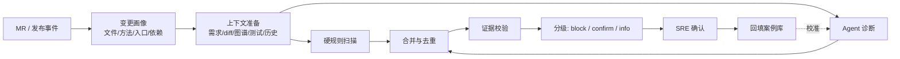

# 应用 AI Coding 代码变更风险评估：工程实现

> 系列：AI SRE 实践笔记 · 05
> 范围：AI Coding 产出的代码在合入前与发布前的风险评估
> 状态：小范围验证中，数据待补
> 背景与判断：[问题与思考](../thinking/05-应用AICoding代码变更风险评估.md)

## 0. 范围与前提

本文实现两个触发点的代码变更风险评估：MR 合入前做代码级初筛，发布前结合影响面做终评。两个触发点共用检查项、证据格式和报告结构，上下文范围和判定阈值不同。

**输入**：

```json
{
  "trigger": "mr | release",
  "repo": "order-service",
  "mr": {"id": 1287, "base": "a1b2c3d", "head": "e4f5g6h", "author": "..."},
  "release": {"change_id": "CHG-2026-1023-033", "version": "v2.15.0", "commit": "e4f5g6h", "window": {}},
  "requirement": {
    "id": "REQ-8821",
    "title": "订单超时关闭支持分批处理",
    "acceptance_criteria": ["超时订单分批拉取", "单批不超过 500 条", "失败可重试"]
  },
  "diff_ref": "a1b2c3d..e4f5g6h",
  "tests": {"changed": ["OrderCloseJobTest"], "coverage_delta": {}, "ci_status": "passed"}
}
```

**输出**：

```json
{
  "assessment_id": "RA-2026-1023-033",
  "trigger": "release",
  "summary": {"block": 0, "confirm": 2, "info": 3},
  "findings": [
    {
      "id": "F1",
      "dimension": "stability",
      "severity": "confirm",
      "title": "批处理循环内逐条调用下游，单批 500 条会放大连接池占用",
      "evidence": [
        {"type": "diff", "ref": "OrderCloseJob.java:88", "note": "for 循环内调用 inventoryClient.release"},
        {"type": "graph", "ref": "entry:job.order-close", "note": "该 Job 与交易主链路共用连接池"},
        {"type": "history", "ref": "INC-2025-0412", "note": "同类逐条调用曾导致连接池打满"},
        {"type": "test", "ref": "OrderCloseJobTest", "note": "未覆盖批次超过 100 的场景"}
      ],
      "impact": {"entries": ["job.order-close"], "dependencies": ["inventory-service"]},
      "suggestion": "改为批量接口，或限制单批大小并加超时与熔断",
      "verification": "压测 500 条/批，观察连接池等待时间"
    }
  ],
  "requirement_traceability": [
    {"criterion": "分批拉取", "status": "covered", "evidence": "OrderCloseJob.java:64"},
    {"criterion": "失败可重试", "status": "unclear", "evidence": "未见重试逻辑"}
  ],
  "data_gaps": ["未获取到该 Job 近 7 天的连接池等待指标"]
}
```

**非目标**：不替代人工签字；不做自动修复；不保证发现全部问题；不评审纯风格与命名问题（只作为 info 级提示）。

**前提**：

- 有代码知识图谱，能提供调用关系、入口类型和代码位置
- MR 能关联到需求单，需求单有验收标准
- 能拿到 CI 测试结果和覆盖率变化
- 有历史故障库，可按模块、接口或代码特征检索相似问题

## 1. 总体链路



三个环节决定成败：

1. **上下文完整性**：需求、图谱、测试、历史缺一样，判断就会退化成看 diff。
2. **证据门槛**：决定报告有没有人看。
3. **分层介入**：合入前和发布前的阈值不同，混在一起会两头不讨好。

## 2. 实现步骤

### 2.1 触发与变更画像

**MR 触发**（合入前）：

- 拉取 base..head 的 diff、变更文件、作者信息
- 关联需求单；关联不上时标记 `requirement_missing`，后续无法判断实现偏差
- 如果研发流程能标记 AI 生成或 AI 辅助，作为统计维度记录，但不改变评估逻辑

**发布触发**（发布前）：

- 以上次发布到本次发布的 commit 区间为准，合并多个 MR
- 关联变更单、发布窗口、涉及应用和接口
- 与合入前的结果做增量合并：已确认的问题保留状态，不重复报告

**变更画像**：

```text
改动文件 → 所属模块 / 负责人 / 是否生成代码（protobuf、ORM 等）
改动方法 → 调用者、入口类型（HTTP / RPC / MQ / Job）
数据与配置 → 涉及的表、配置项、开关
依赖变化 → 新增或调整的远程调用、中间件使用
测试变化 → 新增/修改用例、覆盖率 delta
```

**大 diff 处理**：AI 生成的变更经常一次改动很多文件。按方法切片，优先处理有入口、有调用者、涉及资源操作的方法；生成代码、依赖锁文件、纯格式化改动直接跳过并记录跳过原因。

### 2.2 上下文准备

| 上下文 | 内容 | 缺失时的后果 |
| --- | --- | --- |
| 需求 | 标题、描述、验收标准 | 无法判断实现偏差，只能看代码质量 |
| diff | 按方法切片的变更内容与行号 | — |
| 调用链 | 反向调用者 1~N 跳、入口、下游依赖 | 无法判断影响面，容易把高危改动当局部改动 |
| 数据与配置 | 涉及的表、配置项、开关 | 漏掉事务、容量、回滚类风险 |
| 测试 | 变更用例、覆盖率 delta、CI 结果 | 对「有没有验证过」产生错误信心 |
| 历史 | 相似变更、同模块历史故障、已知风险模式 | 漏掉这个团队真实踩过的坑 |

上下文按优先级组装：diff 与改动方法全量保留；调用链只取有入口的路径；历史检索限制在相似模块和相似代码模式；配置类信息全量保留。超出预算时先裁历史样本，再裁远端调用链，不裁 diff。

### 2.3 检查项与 rubric

每个检查项定义：适用条件、证据要求、默认分级。没有证据要求的检查项不进 rubric。

| 维度 | 检查项示例 | 证据要求 |
| --- | --- | --- |
| 稳定性与性能 | 循环内远程调用、N+1 查询、无界队列、锁粒度过粗、大事务、缓存击穿、重试放大 | 代码位置 + 调用链或依赖 + 数据量假设 |
| 业务逻辑正确性 | 边界与空值、状态机非法流转、事务一致性、幂等、需求实现偏差 | 代码位置 + 需求条款或状态定义 |
| 安全合规 | 注入、越权、密钥硬编码、敏感数据落日志、外部输入未校验 | 代码位置 + 数据流向 |
| 可运维性 | 吞异常、日志缺失或过量、缺超时、不可回滚、配置硬编码、缺开关 | 代码位置 + 配置或发布方式 |

**分级定义**：

| 级别 | 条件 | 处置 |
| --- | --- | --- |
| `block` | 硬规则命中，或证据确定且后果明确（硬编码密钥、明确越权路径） | 阻断合入或发布，必须处理 |
| `confirm` | 有代码与影响面证据，但需要业务判断 | SRE 确认后再决定 |
| `info` | 最佳实践、可维护性建议 | 展示，不阻塞 |

### 2.4 Agent 诊断协议

**两种模式**：

- `pre_merge`：只关注代码本身，输出代码级问题；不判断发布窗口和容量。
- `pre_release`：在代码问题基础上，结合影响面、历史故障、发布方式，输出线上风险。

**Prompt 骨架：**

```text
你是代码变更风险评估员。输入是一次变更的需求、diff、调用链、测试和历史故障信息。
请按给定的检查项评估风险，输出可被复核的发现。

规则：
1. 只能基于输入中出现的代码、需求、调用链和测试信息判断，不得编造文件、行号、调用关系或历史事件。
2. 每条发现必须引用 evidence，并说明它对应哪个检查项、影响哪个入口或依赖。
3. 区分「事实」和「推断」。推断必须写明前提，例如「按当前批大小推算」。
4. 不得自行计算或补全指标；缺失信息写入 data_gaps，不要推测。
5. 需求实现偏差必须引用具体验收标准；没有验收标准时不要臆断偏差。
6. 每条发现给出验证方法；无法验证的降为 info。
7. 同一个根因合并为一条，不要按文件或方法重复报告。
8. 不要输出纯风格、命名、注释类问题；除非它影响可维护性检查项。
9. 安全类发现必须给出数据流向或权限路径。

输入：
<trigger>{...}</trigger>
<requirement>{...}</requirement>
<diff>{...}</diff>
<call_graph>{...}</call_graph>
<tests>{...}</tests>
<history>{...}</history>

输出 JSON，字段遵循给定 schema。
```

**输出校验**（在代码里做）：

- 引用的文件行号必须存在于 diff 或代码库，片段必须能匹配
- 引用的入口、依赖、历史故障 ID 必须存在于输入
- `block` 级必须有硬规则命中，或至少两类独立证据
- 没有 `verification` 的发现降级为 info
- 需求偏差必须引用 `acceptance_criteria` 中的具体条款
- 校验失败 → 重试一次 → 仍失败则只输出硬规则结果

**稳定性**：temperature=0，固定模型、Prompt、rubric 和代码图谱版本，写入报告。

### 2.5 证据校验与分级

硬规则和 Agent 并行跑，硬规则优先：

| 来源 | 示例 | 处置 |
| --- | --- | --- |
| 硬规则 | 密钥、token 出现在代码中；明确的 SQL 拼接注入模式 | 直接 block，模型只做解释 |
| Agent + 硬证据 | 循环内远程调用 + 调用链确认共用连接池 + 历史故障 | confirm 或 block |
| Agent + 弱证据 | 只有代码模式，没有影响面信息 | info 或 confirm，需人工判断 |

**降噪**：

- 按根因合并，不按文件重复
- 每个维度限制输出条数，超出部分折叠为摘要
- 历史相似问题只保留最相关的一条作为佐证
- 对同一仓库的高频问题建立已知基线，避免每次都报

### 2.6 人工确认与反馈

确认动作：确认风险 / 误报 / 已知问题（接受或已排期）/ 需要更多信息。

- 确认风险 → 生成修复建议、补测试要求或回滚预案
- 误报 → 记录原因分类：证据不足、上下文缺失、规则误判、业务约束未表达
- 已知问题 → 关联技术债或工单，后续不再重复报告
- 需要更多信息 → 触发补充上下文（拉取配置、补充需求、补测试）

反馈回填到案例库和 rubric：同一类误报反复出现，优先改规则或补上下文，而不是改 Prompt 措辞。

### 2.7 评测

**回测集**：历史 MR 和发布，标签来自上线后暴露的缺陷、故障复盘、人工确认结论。

| 指标 | 计算方式 |
| --- | --- |
| 风险检出率 | 真实缺陷中被 Agent 提出的比例 |
| 高置信准确率 | block / confirm 中被确认为真的比例 |
| 误报率 | 被标记误报的发现 / 全部发现 |
| 需求偏差识别率 | 有实现偏差的变更中被正确识别的比例 |
| 评审覆盖率 | 接入评估的 MR / 发布占比 |
| 端到端时延 | 事件触发 → 报告产出 |
| 单位评估成本 | tokens + 计算 / 次 |

**分层评测**：按维度、应用等级、变更规模、是否 AI 生成分层。总体指标好看但安全类或大变更系统性漏报，是最危险的情况。

**一致性评测**：同一份输入重复评估，结论应稳定；不一致的样本要定位是上下文裁剪还是模型不确定导致的。

**同源盲区评测**：如果生成代码和评审代码使用同一模型族，专门构造「生成模型容易写错、评审模型也容易放过」的样本集，检验独立信号（规则、图谱、测试）能否兜住。

### 2.8 运行与成本

- **触发**：MR 创建/更新时异步触发；发布单创建时触发终评。两层结果按变更关联
- **耗时拆解**：上下文拉取 → 图谱查询 → 硬规则 → Agent → 校验。MR 场景对时延敏感，超过阈值先返回硬规则结果
- **失败降级**：图谱不可用时只做 diff 级检查；需求缺失时只评代码质量；测试缺失时明确标注「未验证」
- **成本**：按方法切片控制上下文；相同方法体 hash 复用摘要；对低风险变更（纯配置、文档、测试代码）跳过
- **数据安全**：代码送模型前做密钥与凭据过滤；按仓库权限控制访问；保留调用审计

## 3. 小范围验证

目前在部分应用和团队试用，覆盖 MR 合入前和发布前两个触发点。受数据敏感性限制，不披露具体数值。

验证重点放在三件事上：

1. **报告可用性**：研发和 SRE 是否愿意看，误报能不能被压到可接受水平。
2. **上下文价值**：加入调用链、测试和历史故障后，发现质量相对只看 diff 是否明显提升。
3. **分层介入的差异**：合入前和发布前分别适合报什么、阈值怎么定。

试用中确认的几个判断：

- 只给 diff，模型给的建议大多停留在代码风格和通用最佳实践，对线上风险几乎没有判断力。
- 需求缺失时，「实现偏差」这一类检查基本失效，报告价值明显下降。
- 分级比准确率更重要：把所有发现都升级成需要确认，很快就没人处理了。

## 4. 演进计划

| 阶段 | 范围 | 目标 | 验收标准 |
| --- | --- | --- | --- |
| Phase 0 | 单仓库、MR 触发 | 打通 diff 分析 + 硬规则 + 报告 | 报告可读，误报率可接受 |
| Phase 1 | 接入代码图谱与需求 | 影响面与实现偏差检查 | 发现质量相对只看 diff 明显提升 |
| Phase 2 | 接入测试与历史故障 | 证据链完整、分级准确 | 高置信准确率达标 |
| Phase 3 | 发布前终评、多应用 | 两层介入、反馈闭环 | 覆盖率与采纳率持续提升 |

## 5. 已知边界与坑

| 问题 | 影响 | 应对 |
| --- | --- | --- |
| AI 审 AI 同源盲区 | 生成和评审共享同一类错误偏好 | 引入规则、图谱、测试等独立信号；跨模型交叉；用真实故障校准 |
| 需求描述缺失或含糊 | 无法判断实现偏差 | 标记 data_gap，只评代码质量；推动需求单补验收标准 |
| 大 diff 超出上下文 | 后半部分代码被截断，漏报 | 按方法切片、优先有入口的方法、分批处理 |
| 图谱覆盖不全 | 动态调用、反射、生成代码看不到 | 标记未覆盖区域，降低结论置信度 |
| 测试结果造成虚假信心 | 覆盖率高但用例是 AI 自己写的 | 检查用例是否覆盖边界与失败路径，而不只看覆盖率 |
| 误报疲劳 | 报告没人看，方案失效 | 证据门槛、分级、按根因合并、已知问题基线 |
| 安全规则误报 | 研发对安全告警脱敏 | 数据流向证据、白名单、按仓库配置规则 |
| 代码版本与图谱延迟 | 分析的不是最新代码 | 固定 commit，图谱延迟超过阈值时降级 |
| 多语言多框架 | 规则覆盖不均 | 按语言分层评测，优先覆盖核心栈 |
| 责任边界模糊 | AI 结论被当成签字 | 明确 AI 只出假设，确认与签字在人 |
| 代码数据安全 | 源码和密钥外泄 | 送模型前过滤凭据，权限控制与审计 |

## 6. 下一步

1. **检查项库建设**：把历史缺陷和故障反推成检查项，形成可持续维护的 rubric。
2. **同源盲区专项验证**：构造生成与评审共同失效的样本集，量化独立信号的补偿能力。
3. **需求侧治理**：推动需求单提供可验证的验收标准，这是实现偏差检查的前提。
4. **两层结果打通**：合入前发现的问题在发布前继承状态，避免重复报告，也避免问题在合入后被遗忘。
5. **反馈闭环工程化**：误报原因自动归类，驱动规则和上下文调整，而不是靠改 Prompt。
