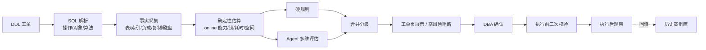

# 数据库 SQL DDL 变更风险识别和提示：工程实现

> 系列：AI SRE 实践笔记 · 06
> 范围：MySQL 主从单库的 DDL 变更评估
> 状态：线上运行（受数据敏感性限制，不披露业务数值）
> 背景与判断：[问题与思考](../thinking/06-数据库DDL变更风险识别和提示.md)

## 0. 范围与前提

本文实现 DDL 工单提交后的自动风险评估：解析 SQL，采集表结构与负载事实，按维度评估风险，高风险阻断，其余交给 DBA 确认。

**输入**：

```json
{
  "change_id": "DDL-2026-1023-011",
  "db": "order_db",
  "sql": "ALTER TABLE orders ADD INDEX idx_user_ctime (user_id, create_time), ALGORITHM=INPLACE, LOCK=NONE",
  "window": {"start": "2026-10-23 02:00", "end": "2026-10-23 04:00"},
  "owner": "...",
  "notes": "支撑订单列表按用户和时间的查询"
}
```

**输出**：

```json
{
  "change_id": "DDL-2026-1023-011",
  "decision": "block | review | pass",
  "snapshot_time": "...",
  "facts": {
    "table_rows": 0,
    "data_size_mb": 0,
    "index_size_mb": 0,
    "qps": 0,
    "disk_free_gb": 0,
    "replication_lag_sec": 0,
    "mysql_version": "8.0.x"
  },
  "findings": [
    {
      "id": "F1",
      "dimension": "execution | performance | capacity | business | rollback | process",
      "level": "block | review | info",
      "title": "大表加索引需要 rebuild，预计持锁与耗时超出窗口",
      "evidence": [
        {"type": "metadata", "ref": "table.rows", "note": "..."},
        {"type": "rule", "ref": "ddl.online_matrix", "note": "..."},
        {"type": "slow_query", "ref": "digest-id", "note": "..."},
        {"type": "history", "ref": "DDL-2025-0731", "note": "..."}
      ],
      "estimate": {
        "metric": "duration",
        "range": ["...", "..."],
        "method": "rows / 估算速率 × 版本系数",
        "confidence": "low | medium | high"
      },
      "suggestion": "改为低峰分批执行，或使用在线变更工具",
      "verification": "在只读副本演练并记录实际耗时"
    }
  ],
  "recheck_required": ["rows_delta", "disk_free", "replication_lag"],
  "data_gaps": []
}
```

**非目标**：不执行 DDL；不生成 SQL 改写；不替代 DBA 签字；不做跨库、分片场景的评估（当前只覆盖 MySQL 主从单库）。

**前提**：

- 数据库为 MySQL 主从架构，版本与关键参数可查
- 有元数据采集能力（information_schema、监控系统）
- 有慢查询日志或 performance_schema，能关联查询与索引
- 有历史 DDL 工单和变更后事件记录
- 工单系统支持回调，能把评估结果和阻断动作挂到审批流

## 1. 总体链路



三个环节决定成败：

1. **事实准确性**：表大小、索引、负载、版本参数错了，后面全错。
2. **估算透明度**：耗时和空间必须给出估算方法和置信度。
3. **执行前二次校验**：评估时的事实到执行时可能已经变了。

## 2. 实现步骤

### 2.1 SQL 解析与变更画像

先判断操作类型，再提取对象和参数：

| 操作 | 关注点 |
| --- | --- |
| `ADD COLUMN` | 是否 nullable、默认值、是否 rebuild、是否影响行格式 |
| `MODIFY / CHANGE COLUMN` | 类型转换、字符集、是否 rebuild、数据兼容 |
| `DROP COLUMN` | 数据丢失、代码依赖、是否可回滚 |
| `ADD INDEX` | 索引列、唯一性、是否 rebuild、写入放大 |
| `DROP INDEX` | 是否被查询使用、有无替代索引 |
| `RENAME / CHANGE ENGINE` | 元数据锁、执行方式、持续时间 |
| `TRUNCATE / DROP TABLE` | 直接高危，硬规则拦截 |

解析输出：

```text
table, operation, columns[], index[], data_type, nullable, default,
algorithm (INPLACE/COPY/默认), lock (NONE/SHARED/EXCLUSIVE/默认),
is_multi_statement, needs_implicit_commit
```

多语句要拆分并保留顺序；DDL 会隐式提交，事务边界要标出来。解析失败或遇到不支持的操作类型时，直接转人工，不强行评估。

### 2.2 事实采集

| 事实 | 来源 | 用途 |
| --- | --- | --- |
| 行数、数据/索引大小、自增 | information_schema / 统计信息 | 耗时、空间、锁的估算基础 |
| 索引列、基数、是否唯一 | information_schema | 写入放大、索引依赖分析 |
| QPS、写 TPS、峰值 | 监控 | 业务影响、窗口建议 |
| 慢查询摘要、执行次数、扫描行数 | 慢日志 / performance_schema | 删索引风险、执行计划影响 |
| 主从延迟、副本数、binlog 格式与量 | 复制状态 | 容量与延迟风险 |
| 磁盘余量 | 监控 | rebuild 空间判断 |
| MySQL 版本与关键参数 | 实例配置 | online DDL 能力矩阵 |
| 业务归属、调用方 | CMDB / 服务依赖 | 影响面判断 |
| 历史 DDL 与变更后事件 | 工单系统 / 故障库 | 相似变更参考 |

每条事实都要带 `snapshot_time`。采集失败或超过新鲜度阈值时，在 `data_gaps` 里标明，相关结论降级。

### 2.3 确定性估算与硬规则

这一层全部用代码和规则完成，模型不参与。

**online DDL 能力矩阵**：按 MySQL 版本、操作类型、是否 rebuild、允许的 LOCK 级别建表。常见的坑是 `ALGORITHM=INPLACE` 并不等于不 rebuild——加索引在部分版本和场景下仍要重建，锁级别和耗时完全不同。

**估算项**：

| 估算 | 方法 |
| --- | --- |
| 执行耗时 | 行数 / 估算速率（按操作类型、版本、硬件系数），给区间 |
| 持锁时间 | 元数据锁 + 执行阶段锁，按版本矩阵判断 |
| 空间放大 | 表大小 × 系数 + 临时文件，判断磁盘余量是否足够 |
| 复制延迟 | 变更产生的 binlog 量 / 从库回放速率 |
| 索引影响 | 被删索引与慢查询的匹配；新增索引对写入的影响 |

**硬规则**（直接阻断或强制加签）：

- 磁盘余量低于 rebuild 所需空间
- 执行窗口落在业务高峰，且操作涉及大表
- 删除被慢查询使用的索引，且无替代索引
- `TRUNCATE`、`DROP TABLE` 等不可逆操作
- 版本未知、算法不支持、解析失败 → 不可判定，转人工

### 2.4 Agent 评估协议

模型拿到的是一份已经算好的事实与估算，负责组合判断和解释。

**Prompt 骨架：**

```text
你是数据库 DDL 变更风险评估员。输入是 DDL、表结构与索引、负载数据、
版本参数、确定性估算结果和历史相似变更。请按给定维度评估风险。

规则：
1. 所有数值只能引用输入中的事实与估算，不得自行计算或编造。
2. 每条发现必须引用 evidence（元数据字段、慢查询摘要、规则 ID、历史工单）。
3. 明确区分事实与估算。估算必须引用输入里的估算方法和区间，不得改写成确定值。
4. 必须结合 MySQL 版本和参数判断执行方式，不能套用通用结论。
5. 影响面判断要引用业务归属、QPS、调用方信息；缺失时写入 data_gaps。
6. 高风险结论要给出可执行的处置建议：执行窗口、分批方式、变更工具、回滚方案。
7. 指标缺失或相互矛盾时输出「不可判定」，不要用常识补位。
8. 同一个根因合并为一条，不按维度重复报告。

输入：
<ddl>{...}</ddl>
<facts>{...}</facts>
<estimates>{...}</estimates>
<slow_queries>{...}</slow_queries>
<history>{...}</history>

输出 JSON，字段遵循给定 schema。
```

**输出校验**（代码侧）：

- 引用的元数据字段、慢查询摘要、历史工单必须存在
- 估算值必须与输入一致，不允许模型改写数字
- `block` 级必须有硬规则命中，或至少两类独立证据
- 没有 `verification` 或处置建议的高危结论降级
- 校验失败 → 重试一次 → 仍失败则只返回硬规则结果

**稳定性**：temperature=0，固定模型、Prompt、规则库和 online DDL 矩阵版本，写入报告。

### 2.5 分级与阻断

硬规则与 Agent 结果按最高级别合并：

| 来源 | 级别 | 动作 |
| --- | --- | --- |
| 硬规则命中 | block | 阻断执行，DBA 处理或申请豁免 |
| Agent + 硬证据 | block / review | 阻断或加签 |
| Agent + 组合判断 | review | 提示，DBA 确认 |
| 无显著风险 | pass | 正常流转，抽样复核 |

**豁免**：必须填写理由和补偿措施（比如改窗口、分批、演练过），留痕并计入豁免率。豁免理由定期复盘，用来调整规则和估算系数。

### 2.6 审核页与执行前二次校验

审核页按 DBA 的判断顺序展示：

1. 结论与阻断原因
2. 关键事实（表大小、QPS、磁盘、延迟、版本）
3. 风险卡片：维度、证据、估算区间与方法、建议
4. 历史相似变更及实际耗时
5. 数据缺口

**执行前二次校验**：执行时重新采集关键事实，与评估快照对比：

- 行数变化超过阈值
- 磁盘余量不足
- 主从延迟偏高
- 当前 QPS 超过评估时的峰值

任一条件触发，暂停执行并重新评估，而不是沿用旧报告。

**执行后观察**：采集执行耗时、锁等待、主从延迟、慢查询变化，回填到历史案例库，作为后续估算的校准数据。

### 2.7 反馈与评测

**DBA 反馈**：确认 / 误报 / 已知风险接受 / 需要更多信息，附原因分类（事实过期、估算偏差、规则误判、业务信息缺失）。

**回测集**：历史 DDL 工单 + 实际执行耗时、锁、复制延迟、变更后事件。

| 指标 | 计算方式 |
| --- | --- |
| 评估覆盖率 | 完成评估的 DDL / 全部 DDL |
| 高危识别率 | 真实高危 DDL 中被阻断或加签的比例 |
| 误报率 | 被判定误报的发现 / 全部发现 |
| 豁免率 | 豁免数 / 被阻断数 |
| 审核时长 | 工单提交 → DBA 确认 |
| 估算偏差 | 预计耗时/延迟与实际值的偏差分布 |
| 变更后故障率 | 执行后引发业务异常的 DDL 占比 |

按操作类型、表规模、业务等级分层看。总体准确率高但大表操作系统性低估，是最危险的情况。

### 2.8 运行与成本

- **触发**：工单提交时异步评估，阻断类结论同步返回
- **耗时拆解**：SQL 解析 → 事实采集 → 估算 → 规则与 Agent → 校验。事实采集慢会拖住整条链路，需要缓存与并行
- **失败降级**：元数据不可用时只做语法与规则检查；慢查询缺失时禁用索引依赖判断；版本未知时不输出执行方式结论
- **成本**：事实采集结果按表缓存；同一 DDL 重复提交复用历史结果；低风险操作（小表、非核心库）可走简化评估
- **权限**：SQL 与表名可能含敏感信息，报告按仓库与业务线控制可见范围

## 3. 线上运行

方案已接入 DDL 工单流程。受数据敏感性限制，本文不披露业务规模与效果数值。

线上运行形态：

- 工单提交后自动评估，高风险在审批页阻断或要求加签
- 评估结论附带关键事实、估算方法与区间，DBA 不需要重新查库
- 执行前自动做二次校验，事实变化超过阈值时要求重新评估
- 所有结论、豁免和二次校验记录留痕，可回溯

线上运行中确认的三个设计取舍：

1. **事实和估算必须由代码算。** 一旦让模型估耗时或行数，报告就不可复核，而这类错误从结论上根本看不出来。
2. **硬规则优先于模型。** 阻断涉及业务可用性，判定必须可解释、可配置；模型负责组合风险和解释。
3. **执行前必须二次校验。** 评估时的事实到执行时可能已经变了，沿用旧快照是这类方案最典型的失效方式。

## 4. 演进计划

| 阶段 | 目标 | 验收标准 |
| --- | --- | --- |
| 已完成 | 工单自动评估、多维风险、阻断与二次校验 | 线上稳定运行 |
| 进行中 | 估算系数校准 | 预计耗时与实际值偏差收敛 |
| 进行中 | 历史案例库结构化 | 相似变更可检索、可引用 |
| 下一步 | 慢查询与索引依赖自动化 | 删索引风险判断不再依赖人工确认 |
| 下一步 | 低峰与分批策略推荐 | 高风险 DDL 能给出可执行窗口建议 |

## 5. 已知边界与坑

| 问题 | 影响 | 应对 |
| --- | --- | --- |
| 元数据过期 | 行数、磁盘、延迟与实际不符 | 快照时间标记 + 执行前二次校验 |
| `INPLACE` 不等于不 rebuild | 耗时和锁被低估 | 按版本与操作查能力矩阵，不按关键字猜 |
| MySQL 版本/参数差异 | 通用结论在特定实例不成立 | 事实里带版本与参数，矩阵按版本维护 |
| 估算偏差 | 时间窗口安排失误 | 给区间与置信度，用执行结果反向校准系数 |
| 删索引影响隐藏查询 | ORM 或动态 SQL 未出现在慢日志中 | 结合 performance_schema、SQL 审计与业务调用信息 |
| 大表操作复制延迟 | 从库落后，读业务异常 | 估算 binlog 量，执行前后监控延迟 |
| 多语句混合 | 隐式提交导致部分成功 | 拆分展示，明确执行顺序与不可逆点 |
| 业务归属不准 | 影响面判断失真 | 从 CMDB 与调用链获取，允许人工修正 |
| 误报累积 | DBA 习惯性点确认 | 证据门槛、分级、豁免率监控 |
| 阻断被绕过 | 线下执行、拆单 | 豁免留痕、阻断原因可申诉、定期复盘 |
| 历史案例质量差 | 参考价值低 | 结构化字段，执行后自动回填 |

## 6. 下一步

1. **估算校准闭环**：用执行后的真实耗时、锁、延迟修正估算系数，按操作类型和表规模分别校准。
2. **索引依赖图谱**：把索引、慢查询、执行计划和应用代码关联起来，删除索引前能自动判断影响。
3. **变更窗口推荐**：结合业务 QPS 曲线和复制压力，给出可执行的低峰窗口，而不是只给风险结论。
4. **与数据库变更平台深度集成**：执行、二次校验、观察、回填串成闭环，减少人工转抄。
5. **扩展数据库形态**：在单库主从稳定后，再评估分库分表和多引擎的适配成本。
