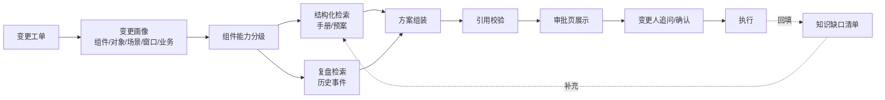

# 系统组件变更风险识别和提示：工程实现

> 系列：AI SRE 实践笔记 · 07
> 范围：DNS、ELB 等基础设施组件的变更方案与风险提示
> 状态：线上运行（受数据敏感性限制，不披露业务数值）
> 背景与判断：[问题与思考](../thinking/07-系统组件变更风险识别和提示.md)

## 0. 范围与前提

本文实现系统组件变更工单的方案生成：从工单提取变更画像，按对象和场景检索手册、预案与复盘，组装成可执行的步骤、风险提示、回滚方案和通知建议，在审批页展示并支持对话追问。

**输入**（以 DNS 和 ELB 为例）：

```json
{
  "change_id": "CHG-2026-1023-047",
  "component": {"type": "dns", "provider": "internal", "version": null},
  "object": {
    "domain": "api.example.com",
    "record_type": "A",
    "current": {"value": "10.0.1.12", "ttl": 300},
    "target": {"value": "10.0.2.12", "ttl": 300}
  },
  "scenario": "modify_record",
  "window": {"start": "2026-10-23 02:00", "end": "2026-10-23 03:00", "timezone": "Asia/Shanghai"},
  "business": [
    {"name": "订单服务", "level": "P0", "owner": "trade-team"}
  ],
  "requester": {"team": "trade-sre", "notes": "机房搬迁，第一批"},
  "attachments": []
}
```

ELB 场景的 `object` 换成 `lb_id / listener / backend_group / instances / weight / health_check`，`scenario` 取 `add_backend / remove_backend / weight_change / certificate_update / listener_change` 等。

**输出**：

```json
{
  "report_id": "SC-2026-1023-047",
  "change_id": "CHG-2026-1023-047",
  "coverage": "full | partial | snippet_only | insufficient",
  "component_grade": "A | B | C | D",
  "prechecks": [
    {"id": "P1", "item": "确认新旧地址均健康", "method": "curl /healthz", "source": "SOP-DNS-03#2.1"}
  ],
  "steps": [
    {
      "seq": 1,
      "action": "将 TTL 由 300 调整为 60，等待原 TTL 过期",
      "command": null,
      "verify": "dig +ttl api.example.com 返回 60",
      "abort_if": "解析结果与预期不符",
      "source": {"type": "sop", "ref": "SOP-DNS-03#3.2", "quote": "..."}
    }
  ],
  "risks": [
    {
      "id": "R1",
      "level": "high | medium | low",
      "title": "TTL 300 意味着回滚最长 5 分钟才全网生效",
      "basis": ["object.ttl", "window.start"],
      "evidence": [{"type": "postmortem", "ref": "INC-2025-0318", "quote": "..."}],
      "mitigation": "先降 TTL 并等待过期，再进行地址切换"
    }
  ],
  "rollback": {
    "triggers": ["核心接口错误率超过阈值", "新地址健康检查失败"],
    "steps": [
      {"seq": 1, "action": "将记录改回 10.0.1.12", "verify": "dig 校验", "source": "SOP-DNS-03#5.1"}
    ],
    "time_limit": "原 TTL 到期时间",
    "post_check": "核心接口成功率恢复"
  },
  "communication": {
    "affected": ["订单服务 (P0)"],
    "before": "变更前 30 分钟通知业务值班",
    "after": "变更完成后同步结果与观察窗口"
  },
  "gaps": ["未获取到该域名下游调用方清单"],
  "escalation": {"owner": "network-team", "channel": "..."}
}
```

**非目标**：不执行变更；不替代审批与签字；不生成知识库以外的命令；不评估成本与容量；不做组件配置采集。

**知识来源**（当前）：运维手册、变更预案、故障复盘与事件记录。历史工单执行记录和配置基线尚未接入，涉及这两类信息时写入 `gaps`。

**前提**：

- 工单字段完整：组件类型、变更对象、场景、窗口、关联业务及等级
- 知识库文档有基本结构（组件、对象、场景、章节），复盘有编号和影响描述
- 每个组件类型有明确负责人，作为升级路径
- 审批页可嵌入报告并支持对话入口

## 1. 总体链路



四个环节决定成败：

1. **画像准确性**：组件类型和对象属性认错，检索全偏。
2. **能力分级**：知识不足时能不能坦率降级。
3. **引用校验**：步骤和命令必须能在原文里找到。
4. **追问闭环**：答不上来的问题要变成知识建设任务。

## 2. 实现步骤

### 2.1 变更画像

先按组件类型提取关键属性，不同类型关注点不同：

| 组件类型 | 关键属性 | 典型场景 |
| --- | --- | --- |
| DNS | 域名、记录类型、记录值、TTL、解析线路 | 新增/修改/删除记录、切换地址、调整 TTL |
| ELB / CLB | 实例、监听、后端组、后端实例、权重、健康检查 | 上下线后端、调权重、改监听、证书更新 |
| CDN | 域名、源站、缓存策略、证书 | 切源、刷缓存、改策略 |
| 证书 | 域名、签发机构、有效期、部署位置 | 续签、替换、吊销 |
| 网络设备 | 设备、接口、ACL、路由 | 策略变更、链路调整 |
| 中间件 | 实例、集群、参数、节点 | 扩缩容、参数调整、节点摘除 |

**场景归一化**：工单里的自由文本先映射到标准场景。映射失败时不猜，标记为 `scenario_unknown`，走降级路径。场景是检索的主键之一，认错场景比认错对象影响更大。

**画像完整性检查**：

- 对象必填字段缺失（比如 ELB 没填后端组）→ 不生成步骤，返回待补充项
- 窗口缺失或跨天 → 提示确认时区
- 业务字段为空 → 影响面和通知部分标缺口，不推断

### 2.2 知识库建设

**两类知识，两种结构：**

| 类型 | 结构要求 | 用途 |
| --- | --- | --- |
| 手册 / 预案 | 组件 → 场景 → 前置检查 / 步骤 / 校验 / 回滚 / 注意事项，按章节编号 | 步骤与回滚的主要来源 |
| 复盘 / 事件 | 事件编号、组件、对象、时间、影响、根因、处置、经验条目 | 风险提示与「踩过的坑」 |

**切片按「对象-场景」而不是按字数**：一个 chunk 对应一个可独立执行的步骤或一条经验，保留章节路径和编号。按固定长度切会把「步骤 3」和它的校验点切开，组装时就会出现有动作没验证的情况。

**元数据**：

```text
component_type, object_type, scenario[], provider, version,
severity, source_type (sop|plan|postmortem), doc_id, section, updated_at,
owner, status (active|deprecated)
```

**质量处理**：

- 标注废弃文档，检索时排除，避免旧手册和现行流程混用
- 同一场景有多份文档时，按更新时间、适用范围、审批状态排序，冲突在报告中显式提示
- 复盘只保留可操作的结论，纯描述性内容不进检索

**入库前的人工校验**：涉及命令和参数的手册，入库时由组件负责人确认一次。之后的更新走同样的确认，避免知识库成为错误命令的放大器。

### 2.3 组件能力分级

全量接入的前提是承认知识密度不均匀。分级结果决定输出形态，不决定是否接入。

| 等级 | 判定条件 | 输出 | 报告字段 |
| --- | --- | --- | --- |
| A | 有现行 SOP + 至少一条相关复盘 + 明确回滚方案 | 完整四段方案 | `coverage: full` |
| B | 有现行 SOP，复盘少或没有 | 步骤与回滚，风险提示注明依据 | `coverage: partial` |
| C | 只有零散文档、旧手册，或缺少回滚章节 | 只给原文片段和待确认项，不给完整步骤 | `coverage: snippet_only` |
| D | 没有可用知识，或对象字段无法识别 | 不生成方案，给负责人和升级路径 | `coverage: insufficient` |

分级按「组件类型 × 场景」算，不按组件整体算。同一个 ELB，上下线后端可能是 A，改监听可能是 C。分级结果缓存，知识库更新后失效重算。

**判定要保守**：拿不准是否满足 A 时按 B 处理。把 B 当 A 报，代价是变更人按不完整的方案执行；把 A 当 B 报，只是少给一点内容。

### 2.4 检索与匹配

**先结构化，后语义**：

1. 按 `component_type + object_type + scenario` 硬过滤，得到候选集
2. 候选集内按 provider / version 过滤，排除不适用版本
3. 语义检索排序，取章节级结果而不是全文
4. 复盘检索放宽一档：同组件不同类型的相似场景也纳入，标记为「同类风险参考」

**查询构造**：用画像字段拼检索语句，而不是把工单原文丢进去。比如「DNS A 记录 修改 TTL 回滚」比整段工单描述更容易命中正确章节。

**窗口和业务等级不参与步骤检索**，它们只影响风险提示和通知建议。步骤来自知识，风险来自「知识 + 本次上下文」，两者混在一起检索会引入无关章节。

**去重与冲突**：

- 同一章节被多路命中只保留一次
- 多份文档步骤不一致时，不自动合并，按来源并列展示并标注冲突
- 复盘中的建议与现行 SOP 冲突时，以 SOP 为准，复盘作为风险提示保留

### 2.5 方案组装协议

模型输入是变更画像、检索到的章节片段、相关复盘和相关规范条目。输出按固定 schema。

**Prompt 骨架：**

```text
你是系统组件变更方案助手。输入是本次变更的画像、知识库检索到的
手册章节和故障复盘。请组装一份可执行的变更方案。

规则：
1. 操作步骤和回滚步骤只能来自输入的手册/预案原文，不得凭经验补充。
   每一步必须给出 source（文档编号 + 章节）。
2. 命令只能在原文明确给出时输出，且必须逐字一致；参数占位符用
   {{...}} 标出，由变更人填写。不得改写、拼接或"优化"命令。
3. 不得编造工单和知识库中没有的事实：下游调用方、架构关系、
   业务影响范围、组件版本能力。缺失写入 gaps。
4. 风险提示必须结合本次对象属性、时间窗口、业务等级，并说明依据
   字段；有复盘支撑的引用事件编号。
5. 每一步要有验证方法和中止条件；原文没有验证方法时标注"待补充"，
   不要自行设计。
6. 回滚方案必须来自原文；原文没有回滚章节时，明确写"知识库中缺少
   回滚方案"，并给出升级联系人。
7. 知识不足以支撑完整方案时，按 C/D 级降级输出，不要用通用经验补齐。
8. 不得输出与本次场景无关的章节内容。

输入：
<change>{...}</change>
<sop_chunks>{...}</sop_chunks>
<postmortems>{...}</postmortems>
<component_grade>{...}</component_grade>

输出 JSON，字段遵循给定 schema。
```

**输出校验**（代码侧）：

- 每个 step / rollback step 的 `source` 必须存在，`quote` 必须能在原文中匹配
- `command` 必须逐字出现在对应章节，否则清空并标记待确认
- A/B 级必须有非空回滚；没有则降级为 C
- 每条 risk 必须引用工单字段或复盘编号，禁止无依据的风险
- 输出条数与场景规模匹配，超出原文范围的步骤整条丢弃
- 校验失败 → 重试一次 → 仍失败则只返回检索原文和负责人

**稳定性**：temperature=0，固定模型、Prompt、知识库版本，报告里记录版本号，便于复现和追责。

### 2.6 风险提示的个性化

风险部分用「规则命中 + 模型解释」的方式生成。规则负责确定性的组合，模型负责说明为什么。

| 规则 | 触发条件 | 提示 |
| --- | --- | --- |
| 回滚窗口 | DNS TTL 大于窗口剩余时间 | 回滚无法在窗口内生效，建议先降 TTL |
| 入口变更 | 组件属于流量入口，且窗口在业务高峰 | 建议改期或增加值守 |
| 核心业务 | 关联业务等级为 P0/P1 | 要求提前通知、分批执行、指定回滚决策人 |
| 后端摘除 | ELB 摘除后端且未先摘流量 | 提示先停流量或调权重，避免请求打到下线实例 |
| 证书替换 | 有效期重叠不足 | 提示重叠期与回滚证书保留 |
| 不可逆操作 | 删除记录、删除监听、吊销证书 | 强制要求确认与备份 |

模型输出时，每条风险要带上触发的字段和依据。规则没有覆盖到的组合风险，模型可以提，但必须引用输入事实，且默认 `medium` 以下，不允许直接给 `high`。

### 2.7 对话追问

审批页提供对话入口，会话绑定当前 `change_id` 和本次报告，不跨工单复用上下文。

**支持的问题类型**：

| 类型 | 示例 | 处理 |
| --- | --- | --- |
| 澄清对象 | 「这次只摘两个后端，另一个不动对吧」 | 回读工单字段确认，字段缺失则让变更人补充 |
| 步骤依据 | 「为什么要先降 TTL」 | 引用对应章节和复盘 |
| 失败处置 | 「健康检查一直失败怎么办」 | 只回答原文中的中止/回滚路径，超出则升级 |
| 影响范围 | 「会影响哪些业务」 | 引用工单关联业务，并说明清单可能不完整 |
| 调整建议 | 「能不能提前半小时」 | 结合窗口规则给判断，不替代审批 |

**边界**：

- 回答只能基于当前工单和本次检索到的知识，检索范围不放宽
- 知识库没有的内容直接说明，并给负责人，不做常识推断
- 每次追问记录问题、是否解决、缺失的知识点
- 追问不改变已生成的报告；需要改方案时重新生成，保留版本

### 2.8 审批页呈现与回填

**展示顺序**按变更人的执行顺序排：

1. 结论与组件等级（A/B/C/D，是否可直接照做）
2. 前置检查
3. 操作步骤（可复制命令，带来源链接）
4. 风险提示（按影响排序）
5. 回滚方案（触发条件、步骤、时间上限）
6. 影响与通知
7. 数据缺口与升级联系人
8. 知识来源列表

**确认与回填**：

- 变更人确认「按方案执行 / 调整后执行 / 不采用」，附原因
- 执行完成后回填：是否按步骤、是否触发中止或回滚、实际耗时、遇到的问题
- 回填结果进入知识缺口清单和方案质量评估，不直接改写知识库

**知识缺口闭环**：C/D 级场景、追问未解决的问题、回填中暴露的缺失步骤，汇总成清单，按组件分给负责人，作为手册和预案的补充需求。

### 2.9 运行与成本

- **触发**：工单提交后异步生成，审批页打开时若未完成则展示进度；对话入口在报告生成后开放
- **耗时拆解**：画像提取 → 分级 → 检索 → 组装 → 校验。检索和组装可以并行多个候选文档
- **缓存**：按「组件 + 对象类型 + 场景 + 知识库版本」缓存方案骨架，对象参数不同时只重算参数和风险部分
- **降级**：检索服务不可用时回退到链接模式；知识库版本不一致时以审批时的快照为准
- **成本**：C/D 级组件直接跳过组装，只做检索和负责人匹配；高频场景复用骨架
- **安全**：命令和拓扑信息按组件和业务线控制可见范围，对话记录留存审计

## 3. 线上运行

方案已接入系统组件变更工单，覆盖工单中可提交的基础设施组件。受数据敏感性限制，本文不披露业务规模与效果数值。

线上运行形态：

- 工单提交后自动生成方案，审批页展示步骤、风险、回滚和通知建议
- 组件按能力分级，知识不足时显式降级，不强行生成完整方案
- 每条步骤和回滚都能点到来源章节或复盘编号
- 变更人可以在审批页追问，追问未解决的问题进入知识缺口清单
- 执行结果回填，用于评估方案质量和发现知识缺失

线上运行中确认的三个设计取舍：

1. **引用可追溯比内容完整更重要。** 少写一条步骤，变更人还能靠经验补；写错一条命令，会被直接执行。所有步骤必须能在原文找到。
2. **能力分级必须显性。** 全量接入后，长尾组件的知识密度差异很大。分级让「不知道」可见，比一份看似完整的通用方案安全。
3. **对话只做澄清，不做扩展。** 放开检索范围会让回答看起来更聪明，但也会把无关甚至过时的内容带进执行环节。

## 4. 演进计划

| 阶段 | 目标 | 验收标准 |
| --- | --- | --- |
| 已完成 | 工单接入、方案生成、分级、引用校验、对话 | 线上稳定运行 |
| 进行中 | 知识缺口闭环 | C/D 级场景持续下降，负责人有明确补充任务 |
| 进行中 | 复盘结构化 | 经验条目可按对象和场景检索 |
| 下一步 | 接入历史工单执行记录 | 实际步骤、耗时、失败点作为方案校准依据 |
| 下一步 | 接入配置基线与依赖关系 | 影响面从工单字段扩展到真实调用方 |
| 下一步 | 执行过程分步引导 | 按步骤给 checklist 和校验结果 |

## 5. 已知边界与坑

| 问题 | 影响 | 应对 |
| --- | --- | --- |
| 长尾组件知识稀疏 | 生成通用内容，误导执行 | 能力分级，C/D 级只给原文和负责人 |
| 模型补全命令 | 错误命令被直接执行 | 命令必须逐字匹配原文，否则清空 |
| 手册过期 | 按旧流程操作 | 文档状态标记，检索排除 deprecated，定期复核 |
| 多份文档冲突 | 方案自相矛盾 | 并列展示并标注，以现行 SOP 为准 |
| 场景识别错误 | 检索到错误章节 | 场景归一化失败即降级，不猜测 |
| 工单字段缺失 | 影响面和通知失真 | 缺口显性化，不推断依赖和重要性 |
| 业务重要性维护不准 | 高风险变更按低风险处理 | 以工单字段为准，冲突时提示人工确认 |
| 时区与窗口理解错误 | 提示的高峰期判断失效 | 工单强制带时区，跨天窗口单独提示 |
| 通用建议稀释重点 | 变更人忽略关键提示 | 风险按影响排序，规则命中优先展示 |
| 过度信任 | 变更人不再看原文 | 保留来源链接，关键操作要求核对原文 |
| 分级被当成质量标签 | 组件负责人只追求升 A | 评审看知识真实性和回滚完整性，不看等级 |
| 对话记录未利用 | 同样的问题反复出现 | 追问未解决项自动进入缺口清单 |

## 6. 下一步

1. **知识缺口运营**：把 C/D 级场景和未解决追问按组件汇总，形成可跟踪的补充任务，并纳入组件负责人的例行工作。
2. **接入执行记录**：历史工单的实际步骤、耗时和失败点，是校准方案和风险提示最直接的证据。
3. **影响面补全**：接入配置基线和依赖关系后，受影响业务从工单字段扩展为真实调用方。
4. **执行期引导**：在变更执行过程中按步骤提供 checklist、校验命令和结果记录，把方案延伸到操作现场。
5. **方案质量评估**：建立抽检机制，按引用准确性、步骤完整性、回滚可执行性打分，驱动知识库和组装逻辑迭代。
