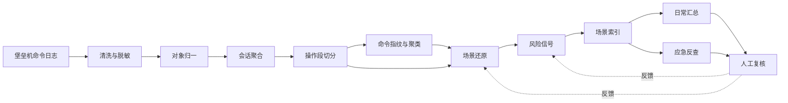

# 黑屏运维操作风险评估：工程实现

> 系列：AI SRE 实践笔记 · 08
> 范围：堡垒机黑屏命令的场景还原、风险洞察与应急反查
> 状态：线上运行（受数据敏感性限制，不披露业务数值）
> 背景与判断：[问题与思考](../thinking/08-黑屏运维操作风险评估.md)

## 0. 范围与前提

本文实现黑屏操作的处理链路：接入堡垒机命令日志，还原会话中的操作段与变更场景，产出风险信号，并支持按对象和时间的应急反查。

**输入**（单条命令事件）：

```json
{
  "event_id": "evt-9f3c21",
  "session_id": "sess-20261023-0417",
  "ts": "2026-10-23T02:14:07+08:00",
  "operator": {"id": "u1024", "name": "...", "team": "dba"},
  "target": {
    "type": "mysql",
    "id": "mysql-order-01",
    "addr": "10.0.3.21",
    "db": "order_db"
  },
  "source_ip": "10.0.9.8",
  "command": "ALTER TABLE orders ADD INDEX idx_user_ctime (user_id, create_time)",
  "protocol": "ssh | db_proxy"
}
```

**没有的字段**：终端输出、执行结果、退出码、文件传输记录、关联变更工单。方案里所有相关结论都要标注这一限制。

**输出**（会话级场景还原）：

```json
{
  "session_id": "sess-20261023-0417",
  "operator": {"id": "u1024", "team": "dba"},
  "start": "...",
  "end": "...",
  "targets": ["mysql-order-01"],
  "segments": [
    {
      "segment_id": "seg-1",
      "start": "...",
      "end": "...",
      "target": {"type": "mysql", "id": "mysql-order-01", "db": "order_db"},
      "command_ids": ["evt-9f3c21", "evt-9f3c22"],
      "scenario": {
        "category": "data_change",
        "object": "order_db.orders",
        "action": "add_index",
        "intent": "为订单表增加联合索引",
        "confidence": "high | medium | low"
      },
      "risk": {
        "level": "high | medium | low",
        "signals": [
          {
            "rule_id": "R-DDL-CORE",
            "title": "核心库执行 DDL",
            "evidence": ["evt-9f3c21", "asset:mysql-order-01:criticality=P0"],
            "needs_review": true
          }
        ]
      },
      "limitations": ["执行结果未知"]
    }
  ],
  "session_risk": {"level": "high", "signal_count": 1},
  "limitations": ["无终端输出", "未关联变更工单"]
}
```

**应急查询输出**：给定对象和时间窗，返回按时间排序的会话与操作段，附操作人、命令摘要、风险信号和原始命令 ID；结尾必须带「相关性不等于因果」的说明。

**非目标**：不阻断命令；不判定违规；不推断命令是否执行成功；不与变更工单比对（当前无关联）；不解析交互式工具内部的输入；不对故障做因果结论。

**前提**：

- 堡垒机命令审计可接入，字段包含会话 ID、操作人、目标、时间、命令
- 有资产清单，能把主机地址和数据库实例归一到对象 ID 及重要性等级
- 有人员与团队信息，用于权限范围和基线
- 有至少一个月的历史数据，用于建立行为基线

## 1. 总体链路



四个环节决定成败：

1. **对象归一**：命令落在错误的对象上，后面全错。
2. **切段质量**：段切错了，场景识别一定错。
3. **结论措辞**：没有输出和工单，任何确定性结论都是过度推断。
4. **查询索引**：应急时搜不到，平时分析再好也没用。

## 2. 实现步骤

### 2.1 接入、清洗与脱敏

| 处理 | 做法 |
| --- | --- |
| 排序 | 按 `session_id` + 事件时间排序；同毫秒用 event_id 兜底 |
| 时钟偏差 | 记录采集端时间与堡垒机时间，偏差超过阈值标记 |
| 会话缺失 | 无 session_id 的记录按「操作人 + 目标 + 10 分钟窗口」临时聚合，标记低置信 |
| 多行命令 | 合并续行，保留原始文本 |
| 交互式命令 | `vim`、`mysql`、`redis-cli` 之后的输入可能不完整，标记 `interactive: true` |
| 脱敏 | `password=`、`--password`、连接串、token、私钥内容替换为 `***`，保留字段名用于识别 |

脱敏在入库前完成，原始数据按安全要求单独存放，仅授权人员可查。送给模型的内容一律使用脱敏后版本。

### 2.2 对象归一

命令里的目标往往是地址、路径、库表名，需要统一到资产对象：

| 输入 | 归一结果 | 失败处理 |
| --- | --- | --- |
| 主机 IP / 主机名 | 资产 ID、业务归属、重要性等级 | 标记 `asset_unknown`，风险信号降级 |
| 数据库实例 | 实例 ID、库名 | 同上 |
| 路径 / 服务名 | 主机 + 服务组件 | 只能落到主机级 |
| 库表 | `db.table` | 解析失败保留原文 |

对象归一直接决定风险判断。同一句 `rm -rf /data/*` 在测试机和核心库主机上不是一回事，归一失败时宁可标未知，也不要按低风险处理。

### 2.3 会话切分与操作段

会话按 `session_id` 聚合，然后在会话内切段。

| 信号 | 默认规则 | 说明 |
| --- | --- | --- |
| 空闲间隔 | 超过阈值切段 | 阈值可配置，按角色区分 |
| 目标切换 | 主机、库、目录发生明显跳转 | 目录跳转只在同主机内生效 |
| 命令族变化 | 文件操作 → 服务管理 → 数据库客户端 | 命令族表维护 |
| 边界命令 | `exit`、`logout`、重新建立连接 | 强制切段 |
| 长任务 | 前后命令围绕同一服务或文件 | 即使间隔长也合并 |

**合并与拆分**：

- 过短的段（单条 `ls`、`pwd`）并入相邻段，作为上下文
- 一次操作跨多个段但对象和意图一致时，在场景层合并，不改变切段结果
- 切段结果保留 `boundary_reason`，方便复核和调参

**判断标准**：一段内的命令应该能用一个「对某对象做了什么」的句子概括。概括不出来，说明切错了。

### 2.4 命令归一化与指纹

把命令转成可比较的指纹，用于聚类、基线和高频模式识别。

```text
fingerprint:
  program: systemctl
  subcommand: restart
  args_pattern: <service>
  flags: []
  risk_tags: [service_disruption]
```

- 变量、路径、IP、库表名替换为占位符，保留结构
- 高危关键字单独打标：`rm`、`dd`、`mkfs`、`drop`、`truncate`、`chmod 777`、`iptables -F`、`> /var/log/*`
- 指纹相同的命令直接复用分类结果，不再调模型
- 指纹分布用于行为基线：某个操作人突然出现从未用过的指纹，本身就是一个信号

### 2.5 场景还原

模型输入是**一个操作段**（不是整段会话，也不是单条命令），加上对象信息和操作人角色。

**Prompt 骨架：**

```text
你是运维操作审计分析员。输入是一段连续的黑屏操作命令，以及目标对象和
操作人信息。请还原这段操作对应的运维场景。

规则：
1. 只能基于输入的命令、对象和操作人信息判断，不得推断命令输出、执行结果
   或未出现的操作。
2. 输出对象、动作、意图三个字段。对象必须来自输入中的目标或命令里明确
   出现的路径/库表；无法确定时填 unknown。
3. 意图用一句话描述，不要扩写成故事，不要补充业务背景。
4. 场景分类只能从给定枚举中选择；无法归类时选 other，并说明原因。
5. confidence 反映证据强度：命令序列完整、对象明确为 high；命令零散或
   含交互式工具为 low。
6. 不得给出「是否成功」「是否违规」「造成了什么影响」的判断。
7. 不引用输入之外的历史事件或资产信息。

场景枚举：巡检、配置变更、服务启停、发布部署、数据查询、数据变更、
备份恢复、故障处置、权限与账号、其他。

输入：
<segment>{commands}</segment>
<target>{...}</target>
<operator>{...}</operator>

输出 JSON。
```

**输出校验**：

- `command_ids` 必须属于该段
- `category` 必须在枚举内
- 对象为 `unknown` 时 `confidence` 不得为 `high`
- 意图描述里不得出现「成功」「失败」「导致」等结果性词汇
- 场景与对象组合明显不合理（如「备份恢复」却只有查询命令）→ 降为 low，进入抽检

**交互式命令处理**：`vim`、`mysql` 会话内的后续输入常常缺失，场景只能还原到「打开了某文件/进入了某库」，不能推断改了什么。这类段单独标记，在报告里明确说明。

### 2.6 风险信号

**规则负责判定，模型负责解释**。高风险必须有规则命中，模型不能单独把某段升为 high。

| 规则 | 触发条件 | 默认级别 |
| --- | --- | --- |
| 核心对象 + 不可逆操作 | P0/P1 资产上出现删除、清库、格式化 | high |
| 高危命令 | 指纹命中高危关键字表 | high（按对象调整） |
| 越权对象 | 操作对象不属于该操作人负责范围 | medium / high |
| 异常时段 | 非值班时段对核心对象做变更类操作 | medium |
| 权限变更 | 修改账号、授权、sudoers、密钥 | high |
| 敏感数据导出 | `mysqldump`、`select ... into outfile`、大批量导出 | medium / high |
| 审计规避迹象 | 清空日志、改审计配置、删除历史文件 | high |
| 批量操作 | 循环、批量脚本对多台目标执行 | medium |
| 行为偏离 | 首次出现的指纹、频次明显异常 | low / medium |
| 数据变更 | 生产库执行 DDL / DML | medium（按对象升级） |

**分级策略**：

- `high`：必须有规则命中 + 对象或命令证据，进入当日重点复核
- `medium`：汇总展示，按对象和操作人聚合，不逐条打扰
- `low`：只入库，用于基线和趋势

**信号不是结论**。每条信号都写成「观察到 X 在 Y 对象上执行了 Z 类操作」，附命令 ID 和对象信息，由人判断是否计划内。没有工单可对比，这个措辞边界必须守住。

**抑制与合并**：同一会话同一对象的同类信号合并；同一操作人重复的相同操作按频次聚合；已知的例行脚本或值班操作进白名单，但白名单本身要定期复核。

### 2.7 存储与索引

| 数据 | 内容 | 保留 |
| --- | --- | --- |
| 命令明细 | 脱敏命令、操作人、对象、时间、会话 | 按审计要求 |
| 操作段 | 起止时间、对象、命令 ID 列表、场景、置信度 | 同上 |
| 会话 | 操作人、目标集合、起止、风险摘要 | 同上 |
| 风险信号 | 规则、级别、证据、复核状态 | 同上 |
| 场景索引 | 对象、时间、操作人、场景、风险级别 | 同上 |

**查询路径**：

- 对象 → 时间窗 → 会话 → 操作段 → 命令（应急主路径）
- 操作人 → 对象 → 时间（人员行为分析）
- 场景类型 + 风险级别 → 时间（日常洞察）
- 命令指纹 → 会话（已知高危命令的扩散排查）

**查询接口**：

```text
GET /audit/timeline
  ?object_id=mysql-order-01
  &from=2026-10-23T01:00:00+08:00
  &to=2026-10-23T03:00:00+08:00
  &include=commands,segments,risk
```

返回按时间排序的操作时间线，跨会话合并，标注每个操作段的对象、场景、风险信号和操作人。

### 2.8 应急反查

**使用流程**：

1. 输入故障对象和时间窗（可由监控告警直接带出）
2. 返回该对象在窗口内的全部操作会话，按时间排序
3. 每个会话展示操作段摘要、命令、风险信号
4. 支持一键展开原始命令，支持按操作人、场景过滤
5. 支持「同操作人在其他对象上的操作」扩展查询，用于识别批量影响

**输出要求**：

- 时间线必须完整，包括正常操作，不能只列风险信号——排除法同样重要
- 明确标注数据边界：无输出、无工单、交互式操作不完整
- 结论措辞为「该时段内存在以下操作」，不写「故障由该操作导致」
- 提供「相关操作」与「无关操作」的人工标记入口，回填后用于改进场景识别

**演练**：定期用历史故障做回放演练，衡量从输入对象到拿到可用时间线的时间，以及是否覆盖到真正的变更操作。

### 2.9 人工复核与反馈

复核动作：确认风险 / 计划内操作 / 误报 / 信息不足。

| 反馈 | 去向 |
| --- | --- |
| 计划内操作 | 进入白名单候选，需二次确认后生效 |
| 误报 | 记录原因：切段错误、对象归一错误、场景识别错误、规则过严 |
| 信息不足 | 标记数据缺口，进入采集能力需求 |
| 确认风险 | 进入改进建议流程 |

反馈优先改规则、对象归一和白名单，而不是改 Prompt 措辞。场景识别的系统性错误，通常是切段或对象问题，不是模型表达问题。

### 2.10 评测

**标注集**：按对象类型、操作人角色、时段分层抽样，人工标注操作段边界、对象、场景和风险结论。

| 指标 | 计算方式 |
| --- | --- |
| 切段准确率 | 与人工标注边界一致的操作段占比 |
| 对象归一准确率 | 对象识别正确的操作段占比 |
| 场景分类准确率 | 场景类别正确的操作段占比 |
| 高风险信号准确率 | 复核确认为风险的比例 |
| 高危操作召回率 | 标注集中的高危操作被识别出的比例 |
| 应急查询命中率 | 故障回放中检索到相关操作的占比 |
| 平均定位时长 | 查询发起到拿到可用时间线的时间 |
| 复核覆盖率 | 被人工复核的高风险信号占比 |

**分层评测**：按对象等级、命令族、会话长度分层。总体准确率高但在核心库和数据库客户端命令上系统性漏报，是最危险的情况。

**一致性**：同一段命令重复分析，场景和风险结论应稳定；不一致的样本优先检查切段和输入截断。

### 2.11 运行与成本

- **批处理**：命令明细实时入库，场景还原按小批次准实时执行；日汇总在凌晨生成
- **成本分层**：指纹命中已知模式的段直接复用结果；只有新指纹、高风险对象、被查询命中的会话走模型
- **上下文控制**：一段只送该段的命令，前后文各带少量命令用于理解，不送整个会话
- **缓存**：相同指纹组合 + 相同对象类型的结果缓存，按知识版本失效
- **失败降级**：模型不可用时只输出规则命中的风险信号和原始命令；切段失败时整段会话作为一段处理
- **权限**：查询结果按资产归属和团队控制；所有查询、导出、复核动作留审计

## 3. 线上运行

方案已接入堡垒机命令审计，覆盖可接入的运维对象。受数据敏感性限制，本文不披露操作规模与效果数值。

线上运行形态：

- 命令按会话聚合并切分为操作段，每段还原对象、动作和场景
- 风险信号按对象重要性和命令危险度分级，高风险进入每日复核清单
- 支持按对象和时间窗反查操作时间线，用于故障定位
- 复核结果回填，用于调整切段规则、对象归一和白名单
- 所有结论标注数据限制：无终端输出、无工单关联、交互式操作不完整

线上运行中确认的三个设计取舍：

1. **场景粒度比命令粒度有用得多。** 单条命令既无法判断意图，也无法判断风险；切段之后的场景还原，是后续所有能力的前提。
2. **没有工单就不做「预期比对」。** 硬要推断「这次操作是否经过审批」，只会产生大量无法证实的结论。方案只描述观察到的操作。
3. **应急反查要列出全部操作，而不只是风险项。** 排除法和确认法同样重要，漏掉正常操作会让排查走偏。

## 4. 演进计划

| 阶段 | 目标 | 验收标准 |
| --- | --- | --- |
| 已完成 | 命令接入、切段、场景还原、风险信号、应急反查 | 线上稳定运行 |
| 进行中 | 切段与对象归一准确率提升 | 分层评测达到目标 |
| 进行中 | 风险信号复核闭环 | 高风险信号准确率稳定，白名单可控 |
| 下一步 | 接入终端输出 | 能判断命令执行结果，结论从「执行了」到「执行结果如何」 |
| 下一步 | 关联变更工单 | 支持预期内/计划外比对 |
| 下一步 | 交互式操作补全 | `vim`、`mysql` 内部操作可还原 |
| 下一步 | 改进建议自动生成 | 从风险信号沉淀出配置与权限治理建议 |

## 5. 已知边界与坑

| 问题 | 影响 | 应对 |
| --- | --- | --- |
| 无终端输出 | 无法判断成功与否、影响是否发生 | 结论限定为「观察到执行」，措辞严格 |
| 无工单关联 | 无法区分计划内与计划外 | 不做预期比对，只给风险信号 |
| 交互式命令缺失 | `vim`、`mysql` 内部操作不可见 | 标记不完整，降低置信度，不推断修改内容 |
| 切段错误 | 场景识别连带出错 | 保留边界原因，分层评测，按角色调阈值 |
| 对象归一失败 | 风险按错误对象评估 | 标 `asset_unknown`，禁止默认低风险 |
| 命令中的变量与别名 | 指纹失真，高危命令被绕过识别 | 别名展开、变量占位、定期更新高危模式 |
| 时钟偏差 | 时间线错序，应急排查误导 | 采集端与堡垒机时间对齐，偏差标记 |
| 会话 ID 缺失 | 聚合错误 | 临时聚合并标低置信 |
| 正常操作被报高危 | 信任下降，报告被忽略 | 高风险必须有规则命中，白名单，聚合展示 |
| 白名单过宽 | 真实风险被抑制 | 白名单定期复核，命中仍需留痕 |
| 结论被当成定责依据 | 使用变形，团队抵触 | 明确「信号非结论」，输出不出现违规判定 |
| 数据敏感 | 密码、连接串、业务数据泄露 | 入库前脱敏，查询按权限，操作留审计 |
| 成本随命令量增长 | 无法持续 | 指纹聚类、分层分析、只对异常段调模型 |

## 6. 下一步

1. **切段与对象归一的专项优化**：这两层是准确率的上限，优先用标注集做系统性改进，而不是调 Prompt。
2. **接入终端输出**：有了执行结果，才能从「执行了什么」走到「造成了什么」，也能显著降低场景误判。
3. **关联变更工单**：在能关联的场景下补上预期比对，把「计划内操作」从人工标记变成自动识别。
4. **应急能力产品化**：与告警、故障处置流程打通，故障发生时自动带出对象和时间窗，减少手工查询。
5. **从信号到治理**：把反复出现的风险信号沉淀为配置规范、权限收敛和操作习惯改进项，形成闭环。
