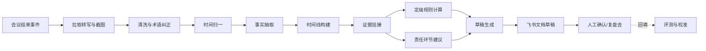

# 故障复盘材料快速生成：工程实现

> 系列：AI SRE 实践笔记 · 09
> 范围：故障应急会议材料的复盘草稿生成、定级与责任环节建议
> 状态：线上运行（受数据敏感性限制，不披露业务数值）
> 背景与判断：[问题与思考](../thinking/09-故障复盘材料快速生成.md)

## 0. 范围与前提

本文实现故障应急会议结束后的复盘草稿生成：接入会议转写与截图，抽取事实、对齐时间线、挂接证据，对照定级规则给出级别建议和责任环节建议，渲染为飞书文档草稿，由风险运营确认后转正式复盘。

**输入**：

```json
{
  "incident_id": "INC-2026-1023-007",
  "meeting": {
    "id": "mtg-88213",
    "title": "订单服务超时应急",
    "start": "2026-10-23T02:03:00+08:00",
    "end": "2026-10-23T03:12:00+08:00",
    "participants": ["u1024", "u2087", "u3310"]
  },
  "transcript": [
    {
      "seg_id": "t-001",
      "speaker_id": "u2087",
      "speaker_name": "...",
      "ts": "2026-10-23T02:05:12+08:00",
      "text": "两点零五分左右开始有告警，订单创建接口超时率上来了"
    }
  ],
  "images": [
    {
      "img_id": "img-01",
      "uploader": "u2087",
      "upload_ts": "2026-10-23T02:06:30+08:00",
      "type": "dashboard",
      "ocr": "10-23 02:04 订单创建 P99 2.3s",
      "caption": "订单创建接口监控"
    }
  ]
}
```

**输出**（结构化草稿）：

```json
{
  "incident_id": "INC-2026-1023-007",
  "status": "draft",
  "summary": {
    "title": "...",
    "start": "...",
    "end": "...",
    "duration_min": 0,
    "affected": ["订单创建接口"],
    "business_level": "P0"
  },
  "timeline": [
    {
      "ts": "2026-10-23T02:04:00+08:00",
      "precision": "exact | approx | inferred",
      "type": "alert | impact | decision | action | recovery | communication",
      "event": "订单创建接口 P99 升至 2.3s",
      "actors": [],
      "evidence": [{"type": "image", "ref": "img-01", "quote": "02:04 P99 2.3s"}],
      "confidence": "high | medium | low"
    }
  ],
  "root_cause_hypotheses": [
    {
      "hypothesis": "...",
      "proposed_by": "u2087",
      "supporting": [{"type": "transcript", "ref": "t-021", "quote": "..."}],
      "counter_evidence": [],
      "verification": "待验证",
      "status": "unconfirmed"
    }
  ],
  "response": [{"ts": "...", "action": "...", "evidence": []}],
  "grading": {
    "suggested_level": "P2",
    "matched_rules": [{"rule_id": "G-IMPACT-02", "description": "...", "params": {}}],
    "missing_params": [],
    "note": "待复盘会确认"
  },
  "responsibility": {
    "suggested_links": [
      {
        "stage": "change | config | capacity | dependency | process | monitoring | test | other",
        "system": "...",
        "team": "...",
        "basis": [{"type": "transcript", "ref": "t-033", "quote": "..."}],
        "alternatives": ["..."],
        "confidence": "medium"
      }
    ],
    "note": "仅为环节建议，不构成个人责任结论"
  },
  "action_items": [{"item": "...", "owner": null, "due": null, "source": "..."}],
  "open_questions": [
    {"question": "两点零七分告警与两点十分发言时间不一致", "needs": "确认准确时间"}
  ],
  "evidence_index": {"transcript": 0, "images": 0}
}
```

**非目标**：不替代复盘会；不给出最终故障级别；不做个人责任认定；不处理音视频原文件；不接入群聊记录；不对根因下最终结论。

**前提**：

- 飞书会议转写可用，包含发言人、时间戳和文本
- 会议中的截图可下载，且能拿到上传人和上传时间
- 定级规则已结构化为可执行条款（参数 + 阈值 + 级别）
- 有统一复盘模板，文档可在飞书内以草稿形式生成
- 有明确的人工确认人和确认流程

## 1. 总体链路



四个环节决定成败：

1. **时间对齐**：时间线错位，整篇复盘都会偏。
2. **事实与判断分离**：混在一起，推测就会被当成结论。
3. **证据挂接**：没有出处的结论无法核对，也无法追责。
4. **确认回填**：没有回填，定级建议永远不会变准。

## 2. 实现步骤

### 2.1 接入与清洗

**转写清洗**：

| 问题 | 处理 |
| --- | --- |
| 口语重复、语气词 | 清洗为书面表达，但保留原话用于引用 |
| 同音字、专有名词错误 | 按故障对象的服务名、组件名、指标名建术语表纠正 |
| 多人抢话、句子截断 | 保留原片段，标记 `fragmented`，不拼接不同人的话 |
| 说话人识别错误 | 允许人工修正；未识别时标 `unknown`，不猜 |
| 长时间静默或离题 | 保留，但标记为 `off_topic`，不进入事实抽取 |

**截图处理**：

- OCR 提取文字，区分告警、监控大盘、聊天截图、架构图、其他
- 记录上传人和上传时间；截图内容里的时间单独抽取
- 图片描述只描述可见内容，不推断截图之外的状态
- 含敏感信息的截图在上传和送模型前脱敏

**保留原文**：清洗后的文本用于抽取，原文片段用于引用。两者用 `seg_id` 关联，保证引用可核对。

### 2.2 时间归一

三类时间源统一到绝对时间：

| 来源 | 示例 | 处理 |
| --- | --- | --- |
| 转写时间戳 | `02:05:12` | 直接使用，表示「说这句话的时间」 |
| 发言中的相对时间 | 「两点零五分左右」「恢复之后」 | 以会议开始或相邻精确事件为锚点推算 |
| 截图内容时间 | 告警卡片 `02:04`、曲线横轴 | OCR 后按日期补全 |

**规则**：

- 相对时间必须标注锚点，如「以会议开始 02:03 为锚点推算」
- 同一事件出现多个时间时并列展示，不取平均、不擅自选择
- 无法确定的时间标 `inferred`，不进入定级参数
- 跨天、跨时区的材料单独提示

**时间线事件 schema**：

```text
ts, precision (exact|approx|inferred), type, event, actors[], evidence[], confidence
```

`type` 限定为：告警、影响、决策、处置、恢复、沟通。这个分类决定了后续能否自动算出持续时长和处置节奏。

### 2.3 事实抽取

**只抽材料中明确陈述的内容**，不做补全。

**Prompt 骨架（事实抽取）：**

```text
你是故障复盘的事实整理助手。输入是一场应急会议的转写片段和截图。
请抽取事实并构建时间线。

规则：
1. 只抽取材料中明确出现的内容。不得补充会议外的排查过程、决策或原因。
2. 区分三类内容：事实陈述、个人推测、待办/承诺。推测必须标注提出者，
   措辞用「某认为/怀疑」，不得改写为事实。
3. 每条事实必须引用 evidence（片段 ID 或截图 ID），引用需能在原文找到。
4. 时间不确定时标 approx 或 inferred，并写明推算依据；多个时间冲突时
   并列输出两个事件，不要合并。
5. 不得替发言者归纳「共识」。不同人的观点分别保留。
6. 按实际发生顺序排列，不按逻辑顺序重排。
7. 截图只描述可见内容；OCR 不确定的字段标 uncertain。
8. 会议中未提及的根因不要提出，留到 open_questions。

输入：
<meeting>{...}</meeting>
<transcript>{...}</transcript>
<images>{...}</images>

输出 JSON。
```

**输出校验**：

- `evidence.ref` 必须存在，`quote` 必须能在对应片段或 OCR 文本中匹配
- `actors` 必须是参会人或材料中出现的人
- `precision=exact` 的事件必须有时间戳或截图时间支撑
- 推测类内容不得出现在 `timeline` 的事实字段中，只能进入假设区
- 无证据的事件整条丢弃

### 2.4 根因整理

**整理，不判定**。把材料里出现过的根因假设逐条列出：

| 字段 | 内容 |
| --- | --- |
| hypothesis | 假设内容，保持提出者的原始表述 |
| proposed_by | 提出人 |
| supporting | 支持证据 |
| counter_evidence | 材料中出现的反证或质疑 |
| verification | 材料中提到的验证方式；没有则写「待验证」 |
| status | 未确认 / 部分验证 / 已确认（仅在材料明确说已确认时） |

**处理原则**：

- 多个假设并列，不自动合并、不排序成「主因/次因」
- 材料里没有根因讨论时，直接写「会议材料中未形成明确根因」
- 模型自己的推断只能放在 `open_questions`，并明确标注是待讨论问题

### 2.5 定级建议

**模型抽参数，规则算级别。**

**定级参数**（按实际规则配置）：

| 参数 | 来源 | 缺失时 |
| --- | --- | --- |
| 影响业务等级 | 故障对象关联的业务 | 无法判定 |
| 影响范围 | 接口、用户、地域、功能 | 按已提及范围给下限 |
| 持续时长 | 时间线首末事件 | 按已知区间，标注不完整 |
| 数据影响 | 是否丢失、错写、泄露 | 未知则列出 |
| 资损与客诉 | 材料中明确提到的 | 未提及视为未知，不视为无 |
| 是否核心链路 | 对象属性 | 无法判定 |

**规则计算**：

```text
输入：参数字典（含每个参数的值、来源、置信度）
输出：候选级别、命中条款、未命中原因、缺失参数
冲突处理：多个条款给出不同级别时，按规则优先级取最高，并展示全部命中
```

**输出要求**：

- 建议级别必须附命中的规则条款和参数值
- 参数缺失或置信度低时，输出区间或「无法判定」，并列出需要确认的项
- 与规则冲突的情况（如时长够但影响不明）单独提示
- 明确写「待复盘会确认」，不出现「最终级别」

### 2.6 责任环节建议

**只到环节、系统和团队，不指向个人。**

| 环节 | 判定依据 |
| --- | --- |
| 变更 | 时间线中存在与故障时间接近的变更操作 |
| 配置 | 配置错误、参数不当、开关误设 |
| 容量 | 资源瓶颈、配额不足、扩容滞后 |
| 依赖 | 上游或下游服务异常 |
| 流程 | 审批、发布、值守、升级流程缺失 |
| 监控 | 发现晚、告警缺失或误报 |
| 测试 | 场景未覆盖、验证不足 |
| 其他 | 材料不足以归类 |

**每条建议包含**：

- 环节、系统、团队
- 支撑证据（时间线节点 + 原始片段）
- 其他可能性（材料中提到的不同判断）
- 置信度

**硬性约束**：

- 材料中没有操作或决策证据时，不给建议，只列待确认
- 不根据发言多少、职级、情绪做判断
- 不输出个人姓名作为责任主体
- 输出区块固定带一句「仅为环节建议，不构成个人责任结论」

### 2.7 草稿生成与证据挂接

**文档结构**（按复盘模板渲染）：

1. 故障概要（时间、时长、影响、级别建议）
2. 影响范围
3. 时间线（表格：时间、类型、事件、证据）
4. 根因分析（假设列表，不合并）
5. 处置过程
6. 定级建议（条款、参数、待确认）
7. 责任环节建议（环节、依据、其他可能）
8. 改进项（待补负责人和期限）
9. 待确认问题
10. 证据索引（转写片段数、截图数、未匹配项）

**证据呈现**：正文中用角标引用，如 `[T-021]`、`[IMG-03]`，文末索引可跳转到原始片段或截图。证据缺失的段落用醒目标记。

**草稿标识**：文档标题带「草稿」，页首注明生成时间、数据范围和「未经确认」状态。飞书文档权限继承会议参与人和故障相关团队。

### 2.8 人工确认与回填

**确认动作**：

- 风险运营编辑草稿，标记每段的处理：采纳 / 修改 / 删除 / 待补
- 定级在复盘会上确认，记录最终级别和调整原因
- 责任环节记录采纳情况：采纳 / 部分采纳 / 不采纳，附原因
- 改进项补充负责人和期限

**回填内容**：

```json
{
  "incident_id": "...",
  "final_level": "P2",
  "level_changed": true,
  "change_reason": "影响范围比材料中描述的大",
  "responsibility_accepted": ["dependency"],
  "responsibility_rejected": [{"stage": "change", "reason": "当时无变更"}],
  "edited_sections": ["timeline", "grading"]
}
```

回填用于三件事：评测定级一致率、校准参数抽取、发现材料缺口。

### 2.9 评测

**标注集**：选取已完成复盘的故障，由风险运营标注关键时间节点、影响参数、最终级别和确认的责任环节。

| 指标 | 计算方式 |
| --- | --- |
| 出稿时长 | 会议结束 → 草稿生成 |
| 事实准确率 | 抽检事件与材料一致的比例 |
| 时间线召回率 | 标注的关键节点被覆盖的比例 |
| 引用准确率 | 证据指向正确片段的比例 |
| 时间精度准确率 | `exact / approx / inferred` 标注正确的比例 |
| 定级一致率 | 建议级别与最终级别一致的比例 |
| 定级参数准确率 | 抽取参数与人工确认一致的比例 |
| 责任环节采纳率 | 建议被采纳或部分采纳的比例 |
| 人工编辑量 | 草稿到终稿的字符修改比例 |
| 幻觉率 | 抽检中无材料依据的陈述占比 |

**分层**：按故障等级、故障类型、会议时长、材料完整度分层。高等级故障的时间线召回要单独看，这类故障恰恰最不能漏。

**回归**：规则或 Prompt 变更后，用同一批标注集回放，对比指标变化。

### 2.10 运行与成本

- **触发**：会议结束事件触发；长会议在结束后先出时间线，再补根因和定级
- **分段处理**：转写按时间窗分段抽取，再合并时间线；合并时按时间去重，冲突保留
- **图片**：先 OCR，只对告警和监控类图片做多模态理解，聊天截图以 OCR 为主
- **时延目标**：草稿在复盘开始前可用；超时先输出时间线和影响范围
- **失败降级**：模型不可用时输出「转写片段索引 + 截图 OCR」，仍可作为人工整理的底稿
- **成本**：术语表、模板和规则本地化；同一故障重复生成复用中间结果
- **安全**：故障材料按故障等级控制可见范围；截图和转写中的敏感信息脱敏；生成与查看留审计

## 3. 线上运行

方案已接入故障应急流程，会议结束后自动生成复盘草稿。受数据敏感性限制，本文不披露故障规模与效果数值。

线上运行形态：

- 会议转写和截图自动拉取，生成带证据的时间线和结构化草稿
- 定级建议由规则计算，参数来源和缺失项一并展示
- 责任建议只到环节和团队，固定标注「不构成个人责任结论」
- 草稿在飞书内以文档形式交付，风险运营编辑后在复盘会确认
- 确认结果回填，用于评测定级一致率和建议采纳率

线上运行中确认的三个设计取舍：

1. **证据挂接比文字流畅重要。** 一份读起来顺但没有出处的复盘，核实成本比手工整理还高。
2. **定级必须由规则算。** 让模型直接给级别，短期看起来准，长期无法解释、无法校准，也无法保证同类故障的一致性。
3. **定责只到环节。** 材料不完整，会议发言带立场，指向个人的结论既不可靠也不合适。

## 4. 演进计划

| 阶段 | 目标 | 验收标准 |
| --- | --- | --- |
| 已完成 | 转写与截图接入、时间线、定级建议、草稿生成 | 线上稳定运行 |
| 进行中 | 定级参数抽取准确率 | 参数准确率与定级一致率达标 |
| 进行中 | 证据挂接与引用校验 | 引用准确率稳定，无出处结论为零 |
| 下一步 | 接入故障群聊记录 | 补齐会议外的处置过程 |
| 下一步 | 接入监控与变更数据 | 时间线可与客观数据交叉验证 |
| 下一步 | 改进项跟踪 | 复盘结论能落到责任人和期限，并跟踪闭环 |
| 下一步 | 历史复盘对比 | 同类故障自动关联，辅助根因分析 |

## 5. 已知边界与坑

| 问题 | 影响 | 应对 |
| --- | --- | --- |
| 转写错误 | 专有名词、数字识别错 | 术语表纠正，关键数字标 uncertain |
| 说话人识别错误 | 观点归属错 | 允许人工修正，不确定标 unknown |
| 口语含糊 | 时间、范围靠推断 | 标 approx/inferred，不进入定级参数 |
| 多时间源冲突 | 时间线错位 | 并列展示，列出待确认 |
| 截图缺上下文 | 误读截图含义 | 只描述可见内容，OCR 存疑标 uncertain |
| 会议外信息缺失 | 排查过程不完整 | 列 `open_questions`，推动补充材料 |
| 模型补全根因 | 推测被当成结论 | 根因只整理不判定，无证据不得进入事实层 |
| 观点被合并成共识 | 掩盖分歧 | 不同人观点分别保留，不归纳共识 |
| 定级参数缺失 | 级别偏高或偏低 | 输出区间或无法判定，列出缺失项 |
| 定责指向个人 | 组织风险，团队抵触 | 只到环节和团队，固定免责说明 |
| 草稿被直接当终稿 | 未经确认就传播 | 文档标「草稿」，确认后转正式 |
| 长会议超出上下文 | 后半段丢失 | 分段抽取 + 时间线合并 |
| 材料质量下降 | 草稿变成噪音 | 设最低材料要求，质量不足时降级为片段索引 |
| 敏感信息泄露 | 故障材料外流 | 权限继承、脱敏、审计 |

## 6. 下一步

1. **定级规则工程化**：把规则从文档变成可执行、可版本化的配置，支持回放和差异对比。
2. **证据链强化**：接入监控、变更、告警数据，让时间线不只依赖会议陈述，能与客观数据交叉验证。
3. **复盘质量评估**：从「有没有写完」转向「关键节点是否覆盖、根因是否有验证、改进项是否闭环」。
4. **历史故障关联**：同类故障自动关联历史复盘，辅助判断根因和改进项是否重复出现。
5. **改进项闭环**：把复盘产出的行动项接入任务系统，跟踪负责人、期限和完成情况。
