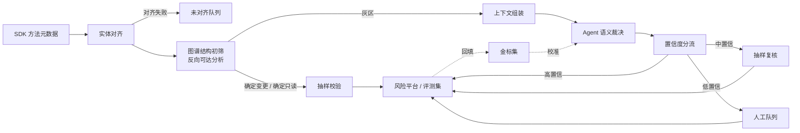

# 变更类操作识别：工程实现

> 系列：AI SRE 实践笔记 · 01
> 状态：小范围验证，数据待补
> 背景与判断：[问题与思考](../thinking/变更类操作识别.md)

## 0. 范围与前提

**输入**：SDK 上报的方法元数据——应用、方法名、描述，以及可选的入口类型（HTTP / RPC / MQ / Job / 内部方法）、调用量。

**输出**：每个方法一条判定记录

```json
{
  "method_id": "com.foo.order.OrderService#queryAndSync",
  "is_change": true,
  "change_types": ["data_write"],
  "confidence": 0.92,
  "evidence": [
    {"file": "OrderService.java", "line": 87, "snippet": "...", "reason": "调用 OrderMapper.insert"},
    {"file": "OrderMapper.xml", "line": 31, "snippet": "INSERT INTO ...", "reason": "写库"}
  ],
  "reason": "方法名为 query 语义，但实现对查询结果执行了 upsert，会改变订单表状态",
  "rubric_version": "2026-10-01",
  "graph_commit": "abc123"
}
```

**非目标**：本方案只负责「是不是变更类、是哪种变更、证据是什么」。风险分级、审批策略、熔断规则属于下游，不在本文范围内。

**前提**：存在可用的代码知识图谱（如 `code-review-graph` 等），能提供符号索引、调用关系、代码位置与片段。

## 1. 总体链路



链路里有两个容易被忽略、但决定成败的环节：

1. **实体对齐率**是覆盖率的上限。SDK 给的名字对不上代码实体，后面的分析再准也没用。
2. **结构初筛**决定了成本。它把 LLM 的输入量从「全部方法」压缩到「灰区方法」。

## 2. 实现步骤

### 2.1 元数据接入与实体对齐

**目标**：把 SDK 的 `(应用, 方法名, 描述)` 映射到图谱中的唯一代码实体。

对齐优先级：

| 优先级 | 策略 | 适用 |
| --- | --- | --- |
| 1 | 应用 + 全限定类名 + 方法名 + 参数签名 | 元数据完整时 |
| 2 | 应用 + 类名 + 方法名 + 参数个数/类型（泛型擦除后） | 签名不规范 |
| 3 | 应用 + 方法名在类内唯一 | 重载可区分 |
| 4 | 应用 + 方法名全局唯一 | 降级，需人工确认 |
| — | 无法对齐 | 进入未对齐队列，按原因分类统计 |

需要处理的坑：

- **重载**：`save(String)` 与 `save(Entity)` 行为可能完全不同，不能只按方法名合并。
- **内部类 / 匿名类**：SDK 可能上报 `Outer$Inner.method`，需与图谱的命名保持一致。
- **Lombok / 注解处理器 / 代码生成**：生成的方法在图谱里可能存在但 SDK 不上报，或反之。
- **多模块同名类**：单仓内可能出现同名全限定类（不同模块），需要模块路径消歧。
- **版本错位**：SDK 上报的是运行中的版本，图谱可能索引的是主干分支。必须记录并对齐 commit / 制品版本。

**产出指标**：对齐率（按应用、按语言分别统计）。未对齐的原因是后续优化的第一优先级，而不是「异常数据」。

### 2.2 副作用 sink 词典

sink 是判定的锚点。需要一份显式维护的词典，覆盖语言和框架。

| 类别 | 典型模式 | 示例 |
| --- | --- | --- |
| DB 写 | `insert / update / delete / upsert / save / merge / flush`；MyBatis mapper 的写语句；JPA `persist` | `OrderMapper.insertWithParam` |
| 缓存写 | `set / put / delete / evict / expire / del` | `redisTemplate.delete(key)` |
| 消息投递 | producer `send / publish / emit / push` | `kafkaTemplate.send(...)` |
| 配置 / 开关 | 配置中心写接口、开关服务写操作 | `configClient.update(...)` |
| 流量 / 路由 | 网关权重、路由规则、限流阈值写 | `routeAdmin.updateWeight(...)` |
| 权限 / 账号 | 授权、角色、密钥变更 | `authService.grantRole(...)` |
| 文件 / 对象存储 | 上传、删除、覆盖 | `ossClient.putObject(...)` |
| 通知 | 短信、邮件、IM、推送 | `smsClient.send(...)` |
| 外部写调用 | 调用其他应用的写接口 | `orderClient.create(...)` |
| 审计（反例） | 写审计日志 | 单独标记，默认不算业务变更 |

**动态 SQL 的处理**：MyBatis XML 里的 `INSERT/UPDATE/DELETE` 要作为 sink 节点纳入图谱；纯字符串拼接的 SQL 无法静态确定，标记为「疑似」，降级到灰区。

**跨应用写**：`orderClient.create()` 是否算 sink，取决于下游应用该接口的标签。这是单仓图谱的边界，见 §5。

### 2.3 反向可达与结构初筛

不做逐方法正向遍历，而是从 sink 反向 BFS：

```python
# 伪代码
def structural_score(method):
    paths = reverse_reachable_paths(
        sink=method,
        max_depth=6,
        graph=call_graph,
    )  # 返回所有从上游方法到该 sink 的路径
    return {
        "has_write_sink": len(paths) > 0,
        "min_distance": min(len(p) for p in paths) if paths else None,
        "write_sink_count": len({p[-1] for p in paths}),
        "conditional_only": all(p.conditional for p in paths),
        "via_async": any(p.async_edge for p in paths),
        "sink_types": {p[-1].category for p in paths},
    }
```

分流规则（需按实际数据调参）：

| 结构分 | 分流 | 建议动作 |
| --- | --- | --- |
| 直接调用写 sink | 确定变更 | 抽样校验（5%~10%） |
| 1~2 跳可达写 sink，且无强条件 | 高概率变更 | 抽样校验 |
| 3 跳以上 / 仅条件分支可达 / 仅缓存写 / 仅跨应用调用 | 灰区 | Agent 裁决 |
| 不可达任何写 sink | 确定只读 | 抽样校验 |

**为什么反向而不是正向**：sink 的数量远少于方法总数，反向遍历可以一次覆盖全图；而且路径本身就是证据，可以直接喂给 Agent。

**成本账**：假设 10 万个方法，灰区占比 20%，则 LLM 调用量约 2 万次，而不是 10 万次。加上方法体 hash 缓存，日常增量可能只有几百次。

### 2.4 上下文组装

Agent 的输入不是整段代码，而是**裁剪后的证据包**。塞得越多，模型越容易走神，成本也越高。

每个方法组装：

1. 方法签名、注释、入口类型
2. 结构分（距离、跳数、sink 类型、是否条件可达）
3. **调用路径**：最多 3 条到 sink 的最短路径，每条路径折叠成 `A -> B -> C` 的形式
4. **关键代码片段**：路径上每个节点的方法体，只保留与调用相关的窗口（写操作前后各 N 行）
5. 反例：同应用中同类型的「只读但看起来像写」的方法，用于校准
6. 线上弱标签（若有）：该方法的写流量、SQL 审计命中情况

**裁剪原则**：

- 优先保留含 sink 的分支，丢弃纯校验、纯日志的分支
- 每条路径的片段总量设 token 上限（例如 4k），超出则保留离 sink 最近的部分
- 不把整个调用树平铺给模型；路径比树更有信息密度，也更像证据

### 2.5 Agent 判定协议

用结构化输出 + 强制引用证据，降低幻觉。

**Prompt 骨架：**

```text
你是变更风险分析员。判断给定方法是否为「变更类操作」。

变更类操作的定义（rubric v2026-10-01）：
- 数据写入、状态流转
- 配置 / 开关变更
- 流量 / 路由变更
- 权限 / 账号变更
- 消息投递
- 外部写调用

不算变更的情形：
- 只写审计日志 / 访问日志
- 纯读取、纯计算
- 幂等令牌、分布式锁等基础设施写入
- 读取开关

判定规则：
1. 必须基于提供的代码片段和调用路径判断，不得凭方法名推测。
2. 方法名与实现语义冲突时，以实现为准。
3. 证据不足时输出 unknown，不要输出猜测。
4. 每条结论必须引用给定的文件与行号；不得编造不存在的代码。
5. 条件分支中才发生的写操作，需说明触发条件。

输入：
<method>{signature}</method>
<description>{description}</description>
<structural_score>{...}</structural_score>
<paths>{...}</paths>
<snippets>{...}</snippets>
<counter_examples>{...}</counter_examples>

输出 JSON，字段遵循给定 schema。
```

**输出校验**（在代码里做，不能只靠模型自觉）：

- `evidence` 中的 `file:line` 必须存在于本次输入
- 引用片段必须能在源码中匹配到
- `confidence` 与证据数量一致性检查（例如 0 条证据却给出 0.95，直接降级）
- 校验失败 → 重试一次 → 仍失败则落入人工队列

**稳定性控制**：temperature=0，固定 Prompt 版本与模型版本并记录到结果里；rubric 变更时跑回归集。

### 2.6 置信度分流

| 置信度 | 处理 | 占比目标 |
| --- | --- | --- |
| ≥ 0.9 且证据完整 | 直接入库 | 尽量高 |
| 0.6 ~ 0.9 | 抽样复核后入库 | 控制在个位数 |
| < 0.6 或 unknown | 人工队列，按潜在风险排序 | 逐步下降 |
| 证据校验失败 | 人工队列并记录失败原因 | — |

人工队列要按**潜在风险**排序，而不是按时间：漏判代价高的（入口方法、高频、涉及资金/权限）优先。这样即使队列积压，也是在最安全的方向上积压。

### 2.7 增量与近实时

触发时机：代码合并（MR/PR 合入）或发布事件。

增量计算：

```text
变更的文件 -> 变更的类/方法集合
           -> 受影响方法 = 变更方法 ∪ 变更方法的上游调用者（反向 1~N 跳）
           -> 对每个受影响方法：
                方法体 hash 未变 且 依赖的 sink 未变 -> 复用上次结果
                否则 -> 重跑结构初筛 + Agent
```

需要注意：

- **上游调用者**必须重算，因为下游方法新增了写操作，上游的判定会变。
- **删除的方法**要从风险平台下线，否则会留下幽灵条目。
- **图谱索引延迟**要监控：合并事件到图谱可用之间的时间，要算进端到端 SLA。
- 全量重算作为兜底（例如每周一次），用于修正增量遗漏。

**实测时延**：【待补】——需区分「合并 → 图谱更新」与「图谱更新 → 标签产出」两段。

### 2.8 评测

**金标集构建**：

- 分层抽样，维度：应用规模、语言/框架、封装深度（1 跳 / 3 跳 / 5 跳以上）、描述有无、是否动态特性重度使用
- 双人独立标注 + 第三方仲裁，记录分歧点（分歧点本身就是 rubric 需要补充的地方）
- 规模：【待补】

**指标定义**：

| 指标 | 计算方式 |
| --- | --- |
| 漏判率 | 金标为变更类、被判为只读或 unknown 的比例 |
| 准确率 | 判为变更类的样本中，金标确认为变更类的比例 |
| 对齐率 | 成功映射到代码实体的方法数 / SDK 上报方法数 |
| 有效覆盖率 | 有判定结果的方法数 / SDK 上报方法数 |
| 端到端时延 | 代码合并时间 → 标签可查询时间 |
| 人工复核占比 | 进入人工队列的方法数 / 总方法数 |
| 单位成本 | 总 tokens 与计算成本 / 已判定方法数 |

**混淆分析**要按维度切开看，而不是只看总体：按语言、按封装深度、按是否有描述、按 sink 类型。总体准确率好看但某一类系统性漏判，是最危险的情况。

## 3. 小范围验证

**范围**：【待补——应用数、方法数、语言栈、框架】

**做法**：在同一批方法上，对比「人工仅凭名字 + 描述标注」与「图谱 + Agent」的结果，以双人金标为基准。

**结果**：

| 指标 | 人工标注基线 | 图谱 + Agent | 说明 |
| --- | --- | --- | --- |
| 准确率 | 【待补】 | 【待补】 | |
| 漏判率 | 【待补】 | 【待补】 | 主指标 |
| 方法级覆盖率 | 【待补】 | 【待补】 | |
| 端到端时延 | 【待补】 | 【待补】 | |
| 人工复核占比 | 100% | 【待补】 | |

**验证中确认的结论**：

- 仅凭名字和描述，SRE 对「名实不符」的方法（`query` 里写库、`update` 只写日志）几乎无法判断；接入代码后这类样本的漏判明显下降。
- 灰区占比与封装深度强相关，跨层越深，规则方案越无力，Agent 的相对价值越大。
- 证据链显著降低了复核成本：复核者不需要重新读代码，只需验证引用的行号。

**验证中暴露的问题**：【待补——例如对齐失败的主要类型、Agent 判定不一致的样本、成本超出预期的环节】

## 4. 落地路线

| 阶段 | 范围 | 目标 | 验收标准 |
| --- | --- | --- | --- |
| Phase 0 | 单应用、单语言 | 打通对齐 + 图谱初筛 + 证据输出 | 对齐率、结构初筛准确率摸底 |
| Phase 1 | 单语言、核心 3~5 个应用 | 接入 Agent，建立灰区判定 | 漏判率相对人工基线显著下降 |
| Phase 2 | 扩展 sink 词典与框架 | 降低灰区占比与人工复核率 | 灰区占比、复核率持续下降 |
| Phase 3 | 接入合并流水线 | 增量更新、近实时产出 | 端到端时延进入分钟级 |
| Phase 4 | 全量 + 跨应用传播 | 风险地图完整 | 覆盖率、跨应用写调用覆盖 |

每个阶段都要先确认上一阶段的**指标可测**，再进入下一阶段。否则很容易做成一个演示效果很好、但无法运营的系统。

## 5. 已知边界与坑

| 问题 | 影响 | 应对 |
| --- | --- | --- |
| 反射 / 动态代理 / SPI | 静态图上不可达，系统性漏判 | 标记为「动态调用点」，提升到灰区；结合线上 trace |
| AOP / 拦截器 | 真实写操作在切面里，方法体看不到 | 图谱需建模切面织入关系；否则降级到灰区 |
| 动态 SQL / 字符串拼接 | 无法静态确定是否写 | 标记「疑似写」，灰区处理 |
| 异步 / 消息消费入口 | 写操作发生在另一条链路 | 需要把 MQ 消费者作为独立入口建模 |
| 定时任务 / 脚本 | 无调用者，从入口反向找不到 | 单独建模 Job 入口 |
| 跨应用写调用 | 单仓图谱无法判定下游语义 | 建立应用间依赖图 + 标签传播；暂按「疑似变更」处理 |
| 图谱腐化 | 判定结果过期 | 增量索引 + 上游重算 + 定期全量兜底 |
| 模型 / Prompt 漂移 | 同一方法判定不一致 | 固定版本、回归集、rubric 变更评审 |
| 成本失控 | 灰区过大导致 LLM 调用暴涨 | 结构初筛阈值调优、上下文裁剪、结果缓存 |
| 误判阻塞发布 | 只读被标为变更，多一层审批 | 提供申诉通道、dry-run、按置信度分级管控 |

## 6. 下一步

1. **补齐验证数据**：样本规模、基线、准确率、漏判率、时延、成本，把 §3 的占位填上。
2. **线上弱标签**：接入 trace / SQL 审计中的写流量，作为高置信正样本，校准静态结果。
3. **跨应用标签传播**：先做应用依赖图，再定义传播规则（A 调用 B 的变更接口，A 是否继承该标签）。
4. **入口级聚合**：方法级判定完成后，按 HTTP/RPC/MQ 入口聚合，输出面向风险运营的视图。
5. **复核工作台**：证据链展示 + 一键确认/驳回 + 结果自动回填金标集，把人工复核变成数据飞轮。
